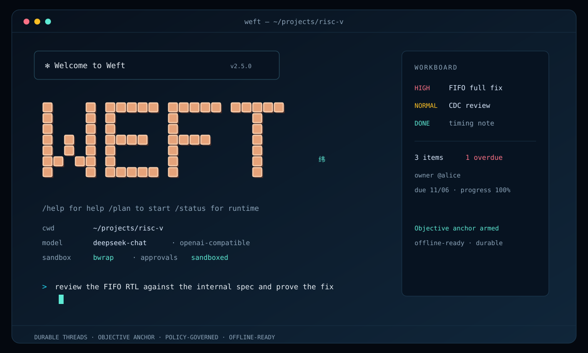

# Weft 纬

### 能长期跑、能追责、能恢复的 Agent Harness

Weft 不是聊天壳，也不是又一个模型客户端。  
它把任务、权限、记忆、工具和界面放进同一个可恢复的运行时，让 Agent 真正能接手长活。

## 它解决什么

大多数 Agent 演示能跑十分钟，但接不了真正的工作：

- 跑一半崩了，上下文和进度都没了
- 权限靠 system prompt 提醒，真出事拦不住
- 长任务没有任务图、检查点和证据
- 记忆散在向量库、缓存和文件里，不知道谁说了算
- 换模型、换 UI、接 HTTP 都要重写一遍

Weft 的做法很直接：**把 Agent 当运行时做，而不是当提示词做。**

## 为什么是 Weft

| 常见做法 | Weft |
|---|---|
| 一次对话一个进程 | Durable Thread + EventLog，重启后继续 |
| “请注意不要删库” | 权限决策、审批缓存、沙箱边界，拒绝有结构化原因 |
| 一个 while 循环跑到底 | Work Graph、Plan、Checkpoint、Evidence |
| 上下文越长越乱 | 请求四区 + 前缀哈希 + 投影压缩 |
| UI 和 core 绑死 | TUI / CLI / HTTP / MCP / Web Surface 共用一套事件 |
| 什么模型都接一点 | ModelProvider 契约，OpenAI-compatible 优先 |

## 核心能力

### Durable Threads

任务不是一次请求，而是一条持久线程。  
消息、事件、租约、Outbox、结果都落到 RuntimeStore；Gateway 重启后还能接着跑。

### Objective Anchor

防止 Agent 从“修一个小问题”一路跑偏到研究整个框架：

- 目标、验收、允许路径、离线约束写入合同
- 越界写文件、联网、装依赖、重复失败、预算耗尽直接停
- 停止时写 `anchor/blocked`，不继续“再研究一下”

### Policy, not prompts

文件、Shell、记忆、KB 全部走同一条权限路径：

- read-only / workspace-write / danger 三档
- allow-once / allow-session / deny
- workspace-guard、bubblewrap、Docker、WSL
- 沙箱不可用直接 fail-closed

### Memory + Knowledge

- SQLite 本地开发，Postgres + pgvector 生产
- 写入版本、冲突消解、tombstone、scope、audit
- Agent 首轮自动注入作用域内记忆
- 本地文档 / HTTP KB / Web / MCP 可切

### Gateway + Workboard

- HTTP Threads / Messages / Events
- SSE 实时事件流
- WorkerPool + Lease + Watchdog
- 统一 Workboard：优先级、负责人、截止时间、进度、逾期
- 签名 Marketplace、OIDC、RBAC、租户配额

### Offline / Hardware

- 断网 reference 情景：FIFO、CDC、timing
- 工具自动发现：PATH、WEFT_EDA_BIN、OSS_CAD_SUITE、PDK_ROOT、OPENLANE_ROOT
- EDA gate 是 fail-closed：没有功能仿真 / coverage / 综合 / PERC 证据，就不算通过
- 当前本机没有 EDA 工具，所以硬件结论仍是 BLOCKED，不冒充 PASS

## 30 秒跑起来

要求：Node.js >= 24。

~~~powershell
git clone https://github.com/czheng5/weft-agnet.git
cd weft-agnet
npm install

# 交互式 CLI
node --experimental-strip-types src/cli.ts

# 离线 demo，不需要模型 key
node --experimental-strip-types src/cli.ts --demo

# 启动 Gateway + Web Surface
node --experimental-strip-types src/cli.ts --serve --port 4780
# http://127.0.0.1:4780
~~~

一条命令安装：

~~~sh
curl -fsSL https://raw.githubusercontent.com/czheng5/weft-agnet/v2.4.1/install.sh | sh
~~~

~~~powershell
irm https://raw.githubusercontent.com/czheng5/weft-agnet/v2.4.1/install.ps1 | iex
~~~

## 模型配置

云端 OpenAI-compatible：

~~~powershell
$env:WEFT_MODEL_API_KEY = "..."
$env:WEFT_MODEL_BASE_URL = "https://api.deepseek.com/v1"
$env:WEFT_MODEL = "deepseek-chat"
node --experimental-strip-types src/cli.ts
~~~

本地模型，无 key：

~~~powershell
node --experimental-strip-types src/cli.ts --model-base-url http://127.0.0.1:11434/v1 --model-name qwen2.5-coder
~~~

Weft 不会把 key 写进仓库，也不在日志里打印 key。CLI 支持从进程环境或 `WEFT_ENV` 读取；testbench 的环境注入仍在 backlog（P0-3）。

## 架构

~~~text
Surface      TUI / CLI / HTTP / MCP / Web
                 │ events
Runtime      Work Graph / Actor / Scheduler / Event Bus / Capability
                 │
Context      Context Projection / Memory Fabric / Knowledge
                 │
Boundary     Policy / Approval / Sandbox / Guardian
~~~

一套 core，多个入口。Surface 不持有业务事实，RuntimeStore 才是事实源。

## 当前状态

- **v2.4.1**：产品 README/Backlog + 天禧概念整合 + EDA/PDK 自动发现
- 133 tests，CI 通过
- 真实 PostgreSQL、Docker、WSL、bubblewrap、长任务、DeepSeek 均有历史验收记录
- 详细发布记录见 [CHANGELOG.md](CHANGELOG.md) 与 [PROJECT_LOG.md](PROJECT_LOG.md)

明确未完成：

- Desktop 壳、跨设备同步协议
- OAuth authorization-code flow / key rotation
- S3/K8s/Nomad 生产 adapter
- 加权公平调度
- EDA 实跑与 PERC 签核（依赖运行环境）
- 真实断网模型 E2E（optional，未用 key）

完整活跃清单：[docs/backlog.md](docs/backlog.md)。

## 文档

| 想了解 | 看这里 |
|---|---|
| 当前 todo 与旧文件对账 | [docs/backlog.md](docs/backlog.md) |
| 产品/设计约束 | [PRD.md](PRD.md)、[ROADMAP.md](ROADMAP.md) |
| 项目管理台账 | [PROJECT_LOG.md](PROJECT_LOG.md) |
| 离线硬件情景 | [docs/closed-world-hardware.md](docs/closed-world-hardware.md) |
| EDA gate | [docs/eda-gated-bench.md](docs/eda-gated-bench.md) |
| Workboard | [docs/workboard.md](docs/workboard.md) |
| 天禧 AI 调研 | [docs/tianxi-ai-integration.md](docs/tianxi-ai-integration.md) |
| 发布说明 | [docs/v2.4-release.md](docs/v2.4-release.md) |
| 接口契约 | [docs/interfaces.md](docs/interfaces.md) |
| 验收证据 | [docs/v1.0-gate.md](docs/v1.0-gate.md)、[docs/acceptance-matrix.md](docs/acceptance-matrix.md) |

## 贡献

- 先读 [docs/backlog.md](docs/backlog.md) 和 [CONTRIBUTING.md](CONTRIBUTING.md)
- 新能力必须带测试/契约，不允许静默降级
- 提交前运行 `node --test --test-isolation=none --experimental-strip-types tests/all.test.ts`
- 安全相关改动更新验收矩阵或 gate 文档

## License

MIT © 2026 Weft contributors。见 [LICENSE](LICENSE)。
