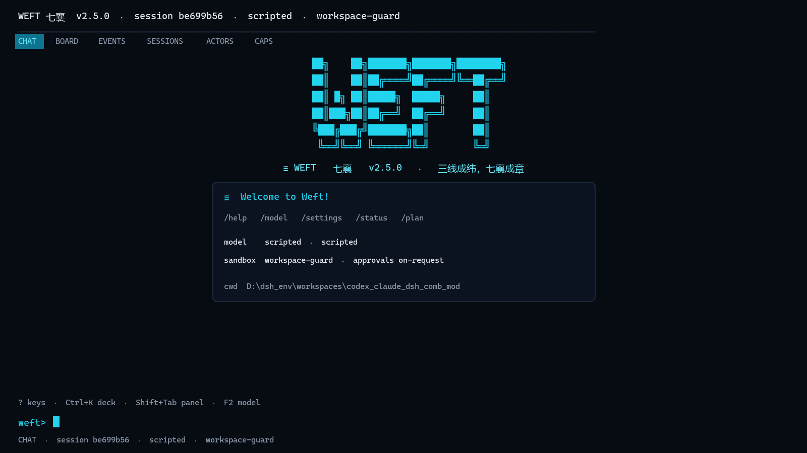

# Weft 七襄

### 能长期跑、能追责、能恢复的 Agent Harness

Weft 不是聊天壳，也不是又一个模型客户端。  
它把任务、权限、记忆、工具和界面放进同一个可恢复的运行时，让 Agent 真正能接手长活。


TUI 是全屏 alternate-screen 界面。下图按实际 TUI 屏幕输出渲染，展示启动态、面板标签、完整 cwd 和固定 composer/footer；运行 `weft` 查看交互界面。



> 图由实际 TUI 屏幕输出渲染，不是手绘示意图；交互、滚动和面板切换请在终端运行查看。

```text
WEFT 七襄  v2.5.0  ·  session <id>  ·  <model>  ·  <sandbox>
──────────────────────────────────────────────────────────────
[CHAT]  BOARD  EVENTS  SESSIONS  ACTORS  CAPS

  WEFT 七襄
  三线成纬，七襄成章
  cwd    /full/workspace/path
  /help  /model  /settings  /status  /plan
  ※ Tip ...

weft> _
  ? keys  ·  Ctrl+K deck  ·  Shift+Tab panel  ·  F2 model
```

## TUI 快捷键

主界面是独立的 alternate-screen 全屏界面：顶部状态栏、面板标签、transcript、固定 composer 和 footer。斜杠命令仍然保留：

| 键 | 动作 |
|---|---|
| `?` | 打开快捷键面板 |
| `Ctrl+K` | 打开 Command Deck 命令面板 |
| `Shift+Tab` | 切换工作面板：CHAT / BOARD / EVENTS / SESSIONS / ACTORS / CAPS |
| `F2` | 模型选择器 |
| `F3` | 设置 / 运行时信息 |
| `/` | 直接输入斜杠命令 |
| `Tab` | 补全斜杠命令 |
| `↑` / `↓` | 历史输入 |
| `Esc` | 清空输入 / 关闭面板 |
| `Ctrl+C` | 清空输入；空输入连按两次退出 |
| `Ctrl+L` | 清屏 |
| `Ctrl+D` | 退出 |
| `Y` / `S` / `N` | 审批：本次 / 本会话 / 拒绝 |

`/keys` 或 `?` 查看完整键位矩阵，`/menu` 或 `Ctrl+K` 打开命令面板；`/model` 或 `F2` 切换模型，`/settings` 或 `F3` 查看设置。菜单、提示和按键行为共用 [src/core/keymap.ts](src/core/keymap.ts) 一份定义。

会话默认持久化到 `.weft/sessions/`：

```bash
weft --continue        # 恢复最近一次会话
weft --resume <id>     # 恢复指定会话
/sessions              # 在 TUI 中列出可恢复会话
```

## 它解决什么

大多数 Agent 演示能跑十分钟，但接不了真正的工作：

- 跑一半崩了，上下文和进度都没了
- 权限靠 system prompt 提醒，真出事拦不住
- 长任务没有任务图、检查点和证据
- 记忆散在向量库、缓存和文件里，不知道谁说了算
- 换模型、换 UI、接 HTTP 都要重写一遍

Weft 的做法很直接：**把 Agent 当运行时做，而不是当提示词做。**

## 为什么是 Weft

| 常见做法 | Weft |
|---|---|
| 一次对话一个进程 | Durable Thread + EventLog，重启后继续 |
| “请注意不要删库” | 权限决策、审批缓存、沙箱边界，拒绝有结构化原因 |
| 一个 while 循环跑到底 | Work Graph、Plan、Checkpoint、Evidence |
| 上下文越长越乱 | 请求四区 + 前缀哈希 + 投影压缩 |
| UI 和 core 绑死 | TUI / CLI / HTTP / MCP / Web Surface 共用一套事件 |
| 什么模型都接一点 | ModelProvider 契约，OpenAI-compatible 优先 |

## 核心能力

### Durable Threads

任务不是一次请求，而是一条持久线程。  
消息、事件、租约、Outbox、结果都落到 RuntimeStore；Gateway 重启后还能接着跑。

### Objective Anchor

防止 Agent 从“修一个小问题”一路跑偏到研究整个框架：

- 目标、验收、允许路径、离线约束写入合同
- 越界写文件、联网、装依赖、重复失败、预算耗尽直接停
- 停止时写 `anchor/blocked`，不继续“再研究一下”

### Policy, not prompts

文件、Shell、记忆、KB 全部走同一条权限路径：

- read-only / workspace-write / danger 三档
- allow-once / allow-session / deny
- workspace-guard、bubblewrap、Docker、WSL
- 沙箱不可用直接 fail-closed

### Memory + Knowledge

- SQLite 本地开发，Postgres + pgvector 生产
- 写入版本、冲突消解、tombstone、scope、audit
- Agent 首轮自动注入作用域内记忆
- 本地文档 / HTTP KB / Web / MCP 可切

### Gateway + Workboard

- HTTP Threads / Messages / Events
- SSE 实时事件流
- WorkerPool + Lease + Watchdog
- 统一 Workboard：优先级、负责人、截止时间、进度、逾期
- 签名 Marketplace、OIDC、RBAC、租户配额

### Offline / Hardware

- 断网 reference 情景：FIFO、CDC、timing
- 工具自动发现：PATH、WEFT_EDA_BIN、OSS_CAD_SUITE、PDK_ROOT、OPENLANE_ROOT
- EDA gate 是 fail-closed：功能仿真、coverage、综合网表、PERC 证据齐全才签核

## 30 秒跑起来

要求：Node.js >= 24。安装完成后的正式入口是 `weft`，`npm start` 只保留给本地开发。

### Linux（推荐）

~~~bash
curl -fsSL https://raw.githubusercontent.com/czheng5/weft-agnet/v2.5.0/install.sh | sh
weft
~~~

`install.sh` 会把启动器写到 `~/.local/bin/weft`；确保该目录在 `PATH` 中，`which weft` 指向它。

### macOS（推荐）

~~~bash
# Node 24（任选其一）
brew install node@24
# 或：nvm install 24 && nvm use 24

curl -fsSL https://raw.githubusercontent.com/czheng5/weft-agnet/v2.5.0/install.sh | sh
weft
~~~

macOS 与 Linux 共用同一个 `install.sh`；`which weft` 应指向 `~/.local/bin/weft`。

也可以从源码安装：

~~~bash
git clone https://github.com/czheng5/weft-agnet.git
cd weft-agnet
npm install
npm link
weft
~~~

`npm link` 会生成全局 `weft` shim；它实际指向 [bin/weft.mjs](bin/weft.mjs)，再由 launcher 启动 [src/cli.ts](src/cli.ts)。Windows 用 `Get-Command weft` 查看路径，macOS/Linux 用 `which weft`。

### Windows

> **Windows 原生版本还在修正一些小问题，推荐使用 WSL2 里的 Linux 环境。**

先装 WSL2（管理员 PowerShell），重启后在 Ubuntu 中执行：

~~~powershell
wsl --install -d Ubuntu
wsl
~~~

~~~bash
# 在 WSL Ubuntu 内
sudo apt update && sudo apt install -y git curl
# 安装 Node 24（推荐 nvm）
curl -o- https://raw.githubusercontent.com/nvm-sh/nvm/v0.40.1/install.sh | bash
source ~/.bashrc
nvm install 24
nvm use 24

curl -fsSL https://raw.githubusercontent.com/czheng5/weft-agnet/v2.5.0/install.sh | sh
weft
~~~

Windows 原生安装脚本仍保留为实验路径：

~~~powershell
irm https://raw.githubusercontent.com/czheng5/weft-agnet/v2.5.0/install.ps1 | iex
~~~

如果 `Get-Command weft` 找不到命令，把 `%USERPROFILE%\.weft\bin` 加入用户 PATH，重新打开 PowerShell；或先在仓库根目录使用 `weft.cmd`。

## 模型配置

云端 OpenAI-compatible：

~~~powershell
$env:WEFT_MODEL_API_KEY = "..."
$env:WEFT_MODEL_BASE_URL = "https://api.deepseek.com/v1"
$env:WEFT_MODEL = "deepseek-chat"
weft
~~~

本地模型，无 key：

~~~powershell
weft --model-base-url http://127.0.0.1:11434/v1 --model-name qwen2.5-coder
~~~

Weft 不会把 key 写进仓库，也不在日志里打印 key。CLI 支持从进程环境或 `WEFT_ENV` 读取；testbench 的环境注入仍在 backlog（P0-3）。

## 架构

~~~text
Surface      TUI / CLI / HTTP / MCP / Web
                 │ events
Runtime      Work Graph / Actor / Scheduler / Event Bus / Capability
                 │
Context      Context Projection / Memory Fabric / Knowledge
                 │
Boundary     Policy / Approval / Sandbox / Guardian
~~~

一套 core，多个入口。Surface 不持有业务事实，RuntimeStore 才是事实源。

## 现在可用

- **v2.5.0**：Durable Thread、Workboard+提醒、Objective Anchor、Gateway/SSE、WorkerPool、OAuth/OIDC、签名 Marketplace、设备同步、PWA、S3/K8s/Nomad、EDA evidence
- 151 tests，CI 通过
- 真实 PostgreSQL、Docker、WSL、bubblewrap、长任务、DeepSeek 均有验收记录
- 发布记录见 [CHANGELOG.md](CHANGELOG.md) 与 [PROJECT_LOG.md](PROJECT_LOG.md)

## 文档

| 想了解 | 看这里 |
|---|---|
| 当前 todo 与旧文件对账 | [docs/backlog.md](docs/backlog.md) |
| 产品/设计约束 | [PRD.md](PRD.md)、[ROADMAP.md](ROADMAP.md) |
| 项目管理台账 | [PROJECT_LOG.md](PROJECT_LOG.md) |
| 离线硬件情景 | [docs/closed-world-hardware.md](docs/closed-world-hardware.md) |
| EDA gate | [docs/eda-gated-bench.md](docs/eda-gated-bench.md) |
| Workboard | [docs/workboard.md](docs/workboard.md) |
| 天禧 AI 调研 | [docs/tianxi-ai-integration.md](docs/tianxi-ai-integration.md) |
| OAuth/PKCE | [docs/oauth-pkce.md](docs/oauth-pkce.md) |
| S3/K8s/Nomad | [docs/production-adapters.md](docs/production-adapters.md) |
| 设备同步 | [docs/device-sync.md](docs/device-sync.md) |
| PWA | [docs/pwa.md](docs/pwa.md) |
| Marketplace | [docs/marketplace-ui.md](docs/marketplace-ui.md) |
| 发布说明 | [docs/v2.4-release.md](docs/v2.4-release.md) |
| 接口契约 | [docs/interfaces.md](docs/interfaces.md) |
| 验收证据 | [docs/v1.0-gate.md](docs/v1.0-gate.md)、[docs/acceptance-matrix.md](docs/acceptance-matrix.md) |

## 贡献

- 先读 [docs/backlog.md](docs/backlog.md) 和 [CONTRIBUTING.md](CONTRIBUTING.md)
- 新能力必须带测试/契约，不允许静默降级
- 提交前运行 `node --test --test-isolation=none --experimental-strip-types tests/all.test.ts`
- 安全相关改动更新验收矩阵或 gate 文档

## License

MIT © 2026 Weft contributors。见 [LICENSE](LICENSE)。

