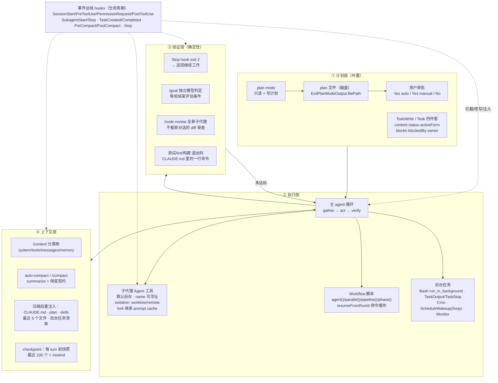

# 02 · Claude Code 的长程规划与执行力：机制拆解、证据分级与可迁移设计

> 研究范围：`repos/claude-code`（commit `80c6959`）、`repos/claude-agent-sdk-python`（`2146f9d`）、`repos/claude-agent-sdk-typescript`（`3a0b748`），以及 npm 分发包 `@anthropic-ai/claude-code@2.1.316`、`@anthropic-ai/claude-agent-sdk@0.3.316`（抓取日 2026-10-31）。
> 本报告严格区分「源码证据 / 分发包观察 / 官方文档 / 官方发布说明 / 推断」，等级定义见 §1.3。

## 0. 摘要（先给结论）

| # | 结论 | 强度 |
|---|---|---|
| 1 | `anthropics/claude-code` **不含 agent 核心实现**：无 `src/`、无 `cli.js`、无 agent loop；仓库 = README + 文档链接 + 示例 + 插件市场清单 + **随二进制一起发布的内置 mod 源码与插件 API 类型声明** | 源码证据（全仓库文件枚举） |
| 2 | npm `@anthropic-ai/claude-code@2.1.316` **已不是 JS 包**：7 个文件/190 KB，只有 `install.cjs`、`cli-wrapper.cjs`、500 B 的 `bin/claude.exe` 和 `sdk-tools.d.ts`；真正实现走 8 个平台原生包 | 分发包观察 |
| 3 | 官方**真正开源**的是 **Python Agent SDK**（完整 `src/`）；TypeScript Agent SDK 仓库**只有示例与脚本，没有 src**，实现仅以 `sdk.mjs`+`sdk.d.ts` 形式分发 | 源码证据 + 分发包观察 |
| 4 | 执行力不是"更聪明的规划器"，而是**把状态、验证、权限、上下文四条流水线外化到 harness**：plan 落盘成文件、完成后由独立模型/Stop hook 判定、transcript 逐行落 jsonl、快照按 turn 存、压缩后按契约重注入 | 多源交叉（L1+L3+L5） |
| 5 | 最能迁移的不是某个 prompt，而是 **"生命周期事件总线 + 分层状态外置 + 压缩留存契约"** 这套骨架；且官方自己正在**去 todo 化**（新模型不再默认给 TodoWrite），说明流程性脚手架要做成可插拔 | 发布说明 + 文档 + 推断 |

---

## 1. 证据边界：先把"仓库里有什么"钉死

### 1.1 三个仓库 + 两个 npm 包的实际内容

| 对象 | 实际内容 | 关键缺口 | 可否作为"实现证据" |
|---|---|---|---|
| `repos/claude-code` | 1,473 个文件；顶层：`.claude/ .claude-plugin/ .devcontainer/ .github/ .vscode/ examples/ mods/ plugins/ Script/ scripts/ CHANGELOG.md CLAUDE.md README.md SECURITY.md demo.gif feed.xml`。**无 `src/`、无 `package.json`、无 `cli.js`** | agent loop、工具实现、压缩算法、权限判定器全部缺失 | 仅能证明"对外接口契约"和"内置插件行为" |
| `repos/claude-agent-sdk-python` | 完整实现：`src/claude_agent_sdk/{client,query,types}.py` + `_internal/{query,sessions,session_resume,session_store,session_mutations,session_summary,transport/subprocess_cli}.py`（`_internal/query.py` 1,098 行、`sessions.py` 1,866 行） | 它只是**子进程协议客户端**，不含模型侧逻辑 | **是**（最高等级，可直接引用行号） |
| `repos/claude-agent-sdk-typescript` | 只有 `README.md / CHANGELOG.md / CLAUDE.md / examples/session-stores/{postgres,redis,s3}` + `scripts/`。**无 src** | 与 python 版不对等 | 否（只能作文档与示例证据） |
| `@anthropic-ai/claude-code@2.1.316` | `package.json` 的 `files` = `bin/claude.exe, install.cjs, cli-wrapper.cjs, sdk-tools.d.ts`；`optionalDependencies` = darwin/linux/win32 × arch × musl 共 8 个原生包；解包 190,269 B | **没有 `cli.js`**，"grep 分发包 JS"这条路径在当前版本失效 | 部分（`sdk-tools.d.ts` = 引擎 tool schema 投影） |
| `@anthropic-ai/claude-agent-sdk@0.3.316` | `sdk.mjs` 1.34 MB、`sdk.d.ts` 570 KB、`sdk-tools.d.ts` 172 KB、`bridge.mjs` 1.07 MB、`browser-sdk.js` 899 KB | `sdk.mjs` 压缩，逻辑不可读；字符串可检索 | 部分（`sdk.d.ts` 是可读 API 契约） |

### 1.2 反直觉但重要：`mods/` 是"引擎接口的公开投影"

`mods/README.md` 开宗明义：*"A mod is a Claude Code plugin whose behaviour lives in a hooks module … These four ship inside Claude Code; this folder is their source, **published as it is built into the binary**"*（mods/README.md:1-4）。也就是说：

- 仓库**不发布 agent 核心**，但**发布了 4 个内置插件（sec-default / diff / telemetry / agents-md）的完整源码**，以及它们的类型基座 `mods/types/claude-code.d.ts`（**12,924 行**）。
- 该 `.d.ts` 由引擎 `/plugin-types` 生成（mods/README.md:108-112 提到 "/plugin-types will put them beside claude-code.d.ts"），因而是**引擎内部接口的机器可读快照**——等级高于文档、低于可执行源码。

### 1.3 证据等级（全文统一）

| 等级 | 含义 | 典型载体 | 可反驳性 |
|---|---|---|---|
| **L1** | 官方开源实现（可读可跑） | `claude-agent-sdk-python/src/**`、仓内 `.claude/**` 配置 | 最高 |
| **L2** | 官方仓库随附的引擎类型声明 | `repos/claude-code/mods/types/claude-code.d.ts` | 高（引擎生成，但非实现） |
| **L3** | 分发包观察（npm tarball 内容/字符串） | `sdk-tools.d.ts`、`sdk.d.ts`、`sdk.mjs` 字符串 | 中高（版本绑定） |
| **L4** | 官方发布说明 | `CHANGELOG.md`（434 个版本，0.2.21→2.1.316） | 中（描述行为，非实现） |
| **L5** | 官方文档 | `code.claude.com/docs/en/*` | 中（随版本变） |
| **L6** | 官方工程博客 | `anthropic.com/engineering/*` | 中 |
| **L7** | 本报告的推断/机制综合 | — | 明确标注 |

---

## 2. 机制总图：执行力 = 四条外置流水线 + 一条事件总线

**一句话**：Claude Code 把「计划、执行上下文、验证、回滚」四件事都搬出了模型上下文，模型只负责在每轮里做局部决策；harness 负责在正确时刻把正确状态**推回**去。

---

## 3. 机制逐条拆解

### 3.1 agentic loop 与 harness 定位

| 项 | 内容 | 证据 | 等级 |
|---|---|---|---|
| 三段循环 | "**gather context, take action, verify results** … These phases blend together" | https://code.claude.com/docs/en/how-claude-code-works.md（The agentic loop 节） | L5 |
| harness 定义 | "Claude Code is the layer around the model that provides the tools and manages the context the model sees. This surrounding layer is what the term **agentic harness** refers to." | 同上 | L5 |
| 工具五分类 | File operations / Search / Execution / Web / Code intelligence | 同上（Tools 节） | L5 |

### 3.2 plan mode：把"计划"变成有协议、有文件、可审批的工件

| 机制点 | 具体做法 | 证据 | 等级 |
|---|---|---|---|
| 模式语义 | `PermissionMode = 'default' \| 'acceptEdits' \| 'bypassPermissions' \| 'plan' \| 'dontAsk' \| 'auto'`；`'plan'` = "Planning mode, no execution of tools" | `repos/claude-code/mods/types/claude-code.d.ts:6105`；`repos/claude-agent-sdk-python/src/claude_agent_sdk/types.py:2386` | L2/L1 |
| 计划协议藏在 system reminder 里 | "`planModeInstructions` … replaces the default code-implementation workflow body in the **plan-mode system reminder**. The CLI still wraps it with the **read-only enforcement preamble** and the **ExitPlanMode protocol footer**." | `report/evidence/claude/npm/sdk-ts/package/sdk.d.ts:2057-2062` | L3（**最关键一条**：plan mode 是"提示词协议 + 工具闸门"，不是独立规划模块） |
| 计划落盘 | `ExitPlanModeOutput` 含 `plan: string\|null`、`filePath?: string`（"The file path where the plan was saved"）、`planWasEdited?`；teammate 向 leader 请求批准时有 `awaitingLeaderApproval/requestId` | `report/evidence/claude/npm/package/sdk-tools.d.ts:3395-3421` | L3 |
| 审批分档 | 计划就绪后三选一：**Yes, and use auto mode** / **Yes, manually approve edits** / **No, keep planning**；批准即退出 plan mode 并切到对应权限模式 | https://code.claude.com/docs/en/permission-modes.md（Review and approve a plan） | L5 |
| 压缩后不丢计划 | 压缩保留表："**The plan Claude wrote in plan mode → Re-injected from disk**" | https://code.claude.com/docs/en/context-window.md（What survives compaction） | L5 |
| 真实工程痛点 | "Fixed hooks and SDK permission callbacks seeing a **missing or outdated plan** on ExitPlanMode when the plan was written in the same response"（2.1.285） | `repos/claude-code/CHANGELOG.md:1948` | L4 |
| 组合缝隙 | "Fixed **plan mode running a write** … that a `PreToolUse` hook or a mod's `tool.check` hook allowed"；bypass permissions 可用时 plan mode 不会问就放行多数编辑 | `CHANGELOG.md:944`、`CHANGELOG.md:833` | L4 |

**机制解读（L7）**：plan mode 的执行力来自三件事同时成立——(a) 写路径被工具闸门锁死；(b) 计划以文件存在于磁盘，压缩/resume 后可重注入，不依赖对话记忆；(c) 退出 plan mode 是**显式协议步**（ExitPlanMode 工具调用），因此可被 hook、SDK、team leader 观测与拦截。

### 3.3 TodoWrite / Task 四件套：计划的最细粒度外置

| 机制点 | 内容 | 证据 | 等级 |
|---|---|---|---|
| TodoWrite schema | `todos: { content, status: pending\|in_progress\|completed, activeForm }[]`；输出带 `oldTodos`/`newTodos` **全量前后快照** | `sdk-tools.d.ts:1101-1110`（入参）、`:3714-3731`（出参） | L3 |
| Task 四件套 | `TaskCreate/TaskGet/TaskUpdate/TaskList`；`TaskUpdate` 支持 `addBlocks`/`addBlockedBy`/`owner`/`metadata`（置 null 删键） | `sdk-tools.d.ts:2805-2870` | L3 |
| 依赖图 | `TaskGetOutput.task` 含 `blocks[] / blockedBy[]`；`TaskListOutput.tasks[]` 含 `owner` | `sdk-tools.d.ts:4022-4050` | L3 |
| 生命周期事件 | `TaskCreated`（TaskCreate 时）、`TaskCompleted`（标记完成时） | https://code.claude.com/docs/en/hooks.md（事件表）；`claude-code.d.ts:4317` 的 `HookInput` union 同列 | L5/L2 |
| **模型代际退役** | "Todo/task-tracking tools (TaskCreate/Get/Update/List, TodoWrite) are **no longer available on Opus 4.8, Sonnet 5, Fable 5, Mythos 5, and newer**；`CLAUDE_CODE_ENABLE_TODO_TOOLS=1` 可恢复"（2.1.233） | `CHANGELOG.md:4288`（版本头 `## 2.1.233` @4269） | L4 |
| 为什么退役 | "**Newer models track multi-step work without a written todo list**"；这些工具现在"只在应用需要渲染进度时才 opt-in" | https://code.claude.com/docs/en/agent-sdk/todo-tracking.md | L5 |

**机制解读（L7）**：todo 列表价值分两层——对**模型**是外部记忆（新模型不需要），对**宿主**是可渲染的结构化进度流（SDK 文档说"仅当你的应用读这些 tool_use 时才开启"）。可迁移结论：**清单类脚手架应做成"给人和宿主看的状态投影"，而非强绑模型推理**。

### 3.4 子代理（Agent 工具）：默认后台 + 可寻址 + 可隔离 + 缓存继承

| 机制点 | 内容 | 证据 | 等级 |
|---|---|---|---|
| 入参 | `description / prompt / subagent_type / model(sonnet\|opus\|haiku\|fable) / effort(low…max) / run_in_background / name / isolation(worktree\|remote)` | `sdk-tools.d.ts:775-816`；`claude-code.d.ts:12634-12652` | L3/L2 |
| 后台是默认 | "`run_in_background` — **Agents run in the background by default; you will be notified when one completes.** Set to false only when your very next action depends on this agent's result" | 同上（`:797-799`） | L3 |
| 可寻址 | "`name` — Makes it **addressable via SendMessage({to: name})** while running" | `sdk-tools.d.ts:800-803` | L3 |
| 隔离 | `isolation: "worktree"` → 临时 git worktree；`"remote"` → 云端且总在后台 | `sdk-tools.d.ts:812-815` | L3 |
| fork 继承 | "Subagent forking is now on by default: `subagent_type: "fork"` **inherits the full conversation and prompt cache**"（2.1.232） | `CHANGELOG.md:4294`（版本头 `:4292`） | L4 |
| 结果形态 | `AgentOutput` 三态：`completed`（`totalToolUseCount/totalDurationMs/totalTokens/usage/toolStats{readCount,bashCount,linesAdded…}`）、`async_launched`（含 **`outputFile`** 供轮询）、`remote_launched`（含 `sessionUrl`） | `sdk-tools.d.ts:102-208` | L3 |
| 事件 | `SubagentStart / SubagentStop`（matcher = agent type，含 `general-purpose / Explore / Plan` 与自定义名） | https://code.claude.com/docs/en/hooks.md 事件表 | L5 |

### 3.5 动态 Workflow：把"编排"写成可缓存、可续跑的脚本

| 机制点 | 内容 | 证据 | 等级 |
|---|---|---|---|
| 形态 | `Workflow.script` 必须以 `export const meta = { name, description, phases }` 开头，正文用 `agent()/parallel()/pipeline()/phase()` | `sdk-tools.d.ts:2872-2903`；`claude-code.d.ts:12828-12843` | L3/L2 |
| 落盘 + 迭代 | "Every Workflow invocation **persists its script under the session directory and returns the path**… edit that file with Write/Edit and re-invoke with the same `scriptPath`" | `sdk-tools.d.ts:2896-2898` | L3 |
| **增量续跑** | "`resumeFromRunId` — … **Completed `agent()` calls with unchanged (prompt, opts) return their cached results instantly; only edited or new calls re-run.**" | `sdk-tools.d.ts:2900-2902` | L3 |
| 运行时真实存在 | "Fixed a failed `agent()`, `parallel()` or `pipeline()` call that a workflow script awaits later, or not at all, being treated as an **unhandled promise rejection, which could end a background session**"（2.1.285） | `CHANGELOG.md:1951` | L4 |
| 官方说明 | "Dynamic workflows orchestrate many subagents from a script Claude writes and you can rerun. Use them for codebase audits, large migrations, and cross-checked research." | https://code.claude.com/docs/en/workflows.md | L5 |

**机制解读（L7）**：这是从"单 agent 循环"走向"可重放 DAG"的关键：脚本即工件、节点级内容寻址缓存（prompt+opts 未变即命中）。长程任务里最被低估的执行力来源——重跑 100 个 agent 的流水线，只重算被改动的那几个。

### 3.6 Hooks：唯一稳定的"可编程缝"

| 机制点 | 内容 | 证据 | 等级 |
|---|---|---|---|
| 三种节奏 | per session（`SessionStart/End`）、per turn（`UserPromptSubmit/Stop/StopFailure`）、每次工具调用（`PreToolUse/PostToolUse`，`EndConversation` 跳过） | https://code.claude.com/docs/en/hooks.md（Hook lifecycle） | L5 |
| 事件全集 | SessionStart/Setup/UserPromptSubmit/UserPromptExpansion/PreToolUse/PermissionRequest/PermissionDenied/PostToolUse/PostToolUseFailure/PostToolBatch/Notification/MessageDisplay/SubagentStart/SubagentStop/TaskCreated/TaskCompleted/Stop/StopFailure/TeammateIdle/InstructionsLoaded/ConfigChange/CwdChanged/DirectoryAdded/FileChanged/WorktreeCreate/WorktreeRemove/PreCompact/PostCompact/PreModelSwitch/PostModelSwitch/Elicitation/ElicitationResult/SessionEnd | hooks.md 表格；与 `claude-code.d.ts:4317` 的 `HookInput` union 逐项对齐 | L5+L2（**两条独立来源互证**） |
| 阻断语义 | `Stop` hook 以 exit code 2 结束 → "sends Claude back to work … the turn doesn't end until the typecheck passes or the block limit is reached" | https://code.claude.com/docs/en/best-practices.md（Enforce the check with a Stop hook） | L5 |
| 压缩钩子 | `PreCompact/PostCompact`，matcher = `manual\|auto` | hooks.md；`types.py:461-466` 的 `trigger: Literal["manual","auto"]` | L5/L1 |
| 派发模型 | "multiple matchers registered on the same event are dispatched **concurrently** … do not rely on one completing before another starts" | `repos/claude-agent-sdk-python/src/claude_agent_sdk/types.py:2531-2542` | L1 |
| 真实用例（Anthropic 自己） | `.claude/settings.json`：`permissions.allow` 放行 5 条验证命令（ruff check / ruff format / mypy / pytest ×2）；`PostToolUse`（matcher `Edit\|Write\|MultiEdit`）跑 `ruff check --fix && ruff format` | `repos/claude-agent-sdk-python/.claude/settings.json:1-25` | L1 |
| 函数式 hooks | 插件可在**引擎进程内**注册 TS 函数 hook（`register(on, options)` / `($, e, next)`），能画 UI 也能改事件 | `repos/claude-code/mods/README.md:1-6,22-68`；`claude-code.d.ts:4329` | L1/L2 |

### 3.7 Skills：上下文过滤 + 渐进披露

| 机制点 | 内容 | 证据 | 等级 |
|---|---|---|---|
| SDK 语义 | `skills: list[str] \| "all" \| None`；"This is a **context filter, not a sandbox**: unlisted skills are hidden from the model's listing and rejected by the Skill tool, but their files remain on disk and are reachable via Read/Bash" | `types.py:2665-2685` | L1 |
| 工具入参 | `Skill{ skill, args }`，"Do not guess names" | `sdk-tools.d.ts`（SkillInput）；`claude-code.d.ts:12788-12793` | L3/L2 |
| 压缩留存 | "Skill descriptions → **Rebuilt from your current skills and re-injected**（≥2.1.304）"；"Invoked skill bodies → Re-injected, **capped at 5,000 tokens per skill and 25,000 tokens total**, oldest dropped first" | https://code.claude.com/docs/en/context-window.md | L5 |
| 注入类型学 | 引擎注入的 attachment 含 `skill_listing`、`instructions`、`nested_memory`、`todo_reminder`、`plan_mode`、`plan_mode_exit`、`auto_mode`、`deferred_tools_delta` 等 | `claude-code.d.ts:6582-6590` | L2 |
| 可过滤 | `on("prompt.attachment", { type: "todo_reminder" }, () => ({ text: null }))` — 插件可按类型删注入 | `claude-code.d.ts:3465` | L2 |

### 3.8 CLAUDE.md / rules / auto memory：启动即注入 + 按需懒加载

| 机制点 | 内容 | 证据 | 等级 |
|---|---|---|---|
| 加载算法 | 从 cwd 向上每层 `CLAUDE.md`/`CLAUDE.local.md` **全部拼接**（不覆盖），顺序"根 → cwd"，同层 `CLAUDE.local.md` 在后 | https://code.claude.com/docs/en/memory.md（How CLAUDE.md files load） | L5 |
| 子目录懒加载 | 只有 Claude **读/写/编辑**该子目录下另一文件时才加载该子目录 CLAUDE.md（Bash 的 `cat` 也算读） | 同上 | L5 |
| 路径域规则 | `.claude/rules/*.md` 支持 `paths: ["src/api/**/*.ts"]` frontmatter，命中才加载 | memory.md（Path-specific rules） | L5 |
| 建议体量 | 表格写 "**200 lines or 25KB**" 上限 | memory.md | L5 |
| SDK 开关 | `setting_sources=[]` 关文件系统设置（隔离模式）；"Must include `"project"` to load CLAUDE.md files" | `types.py:2653-2663` | L1 |
| 引擎内祖先查找 | `$.fs.ancestors({names:["AGENTS.md"], of, below})` — "the way the engine reads CLAUDE.md"，含 `@include` 展开 | `claude-code.d.ts:2843-2863` | L2 |
| 压缩后 | "Project-root CLAUDE.md and unscoped rules → **Re-injected from disk**"；"Nested CLAUDE.md → reload on demand" | context-window.md | L5 |
| 与确定性规则的分工 | "Claude treats them as context, **not enforced configuration**. To block an action regardless of what Claude decides, use a `PreToolUse` hook instead." | memory.md | L5 |

### 3.9 Compaction / context editing：不是"截断"，是"带契约的重建"

| 机制点 | 内容 | 证据 | 等级 |
|---|---|---|---|
| 触发 | auto-compact 由阈值与 "auto-compact window" 决定；模型不认识时按 200K 假设 | `ContextUsageResponse.isAutoCompactEnabled / autoCompactThreshold / maxTokens`（`types.py:1024-1087`）；`CHANGELOG.md:30` | L1/L4 |
| 分类账 | `/context` 把占用拆成 system prompt / tools / messages / memoryFiles / mcpTools / agents / skills / slashCommands / apiUsage | `types.py:1024-1087` | L1 |
| 手动/自动统一 | `$.session.compact()` = "/compact 同一调用"，事件 `session.compact`（trigger=`plugin`），可被 hook veto（`{skip}`） | `claude-code.d.ts:2448-2457` | L2 |
| 压缩后留存契约 | 见下表 | context-window.md | L5 |
| 子代理单独窗口 | "Added `autoCompactWindow` to subagent frontmatter … a subagent can auto-compact earlier than the main conversation's window"（2.1.296） | `CHANGELOG.md:1017` | L4 |
| 空闲压缩 | "idle compaction … a 200K+ token conversation left idle is summarized, and the summary is used on your next message if the prompt cache has expired"（2.1.314） | `CHANGELOG.md:66` | L4 |
| hook 侧稳定性 | "Fixed a PreCompact hook with very large output making compaction fail or repeat; **each hook's output is now cut at 10,000 characters**" | `CHANGELOG.md:84` | L4 |
| 官方方法 | compaction / structured note-taking / sub-agent 三选一：compaction 保对话流、note-taking 保里程碑、多智能体保并行探索 | https://www.anthropic.com/engineering/effective-context-engineering-for-ai-agents | L6 |

**压缩留存契约（据 context-window.md 整理）**

| 内容 | 压缩后 |
|---|---|
| system prompt / output style | 仍生效 |
| 项目根 CLAUDE.md、无 scope 的 rules | **从磁盘重注入** |
| auto memory | 从磁盘重注入 |
| skill 描述 | 按当前 skills 重建（≥2.1.304） |
| git status 快照 | 重新读一次 |
| **plan mode 写的 plan** | **从磁盘重注入** |
| `paths:` 规则、嵌套 CLAUDE.md | 按需重新加载 |
| Claude 读/写过的文件 | 重读最多 5 个（最近修改优先） |
| 已调用 skill 的正文 | 重注入，5,000 tok/skill、25,000 tok 总上限，最旧先丢 |
| 后台命令 / 后台子代理 | **继续运行**，并提醒 Claude"还在跑"，避免重复启动 |
| 早期 hooks 注入的上下文 | 与对话一起被摘要（**会丢**） |

### 3.10 Checkpointing / rewind：把"turn"变成可回滚单元

| 机制点 | 内容 | 证据 | 等级 |
|---|---|---|---|
| 粒度 | "captures the state of your code **before each prompt you send that starts a turn**"；保留最近 **100** 个；"saves checkpoints **with the conversation**, so you can still `/rewind` after you resume" | https://code.claude.com/docs/en/checkpointing.md | L5 |
| 菜单选项 | Restore code and conversation / conversation only / code only / Summarize from here（后两项与 `DISABLE_COMPACT` 有交互，见 `CHANGELOG.md:261`） | checkpointing.md；`CHANGELOG.md:261` | L5/L4 |
| SDK 侧 | `enable_file_checkpointing: bool`（"files can be rewound to their state at any user message using `ClaudeSDKClient.rewind_files()`"）；控制请求 `{subtype:"rewind_files", user_message_id}` | `types.py:2751-2757`、`:2843-2845` | L1 |
| TS 侧 | `enableFileCheckpointing` + `Query.rewindFiles(userMessageId)` | `sdk.d.ts:1746-1754`、`:3227` | L3 |
| 明确局限 | Bash 命令改动**不追踪**；子代理编辑**不恢复**；外部改动不追踪；mid-turn 消息不 checkpoint；符号/硬链接不恢复；"Not a replacement for version control" | checkpointing.md（Limitations） | L5 |
| 存储治理 | "Reduced session transcript size (up to 79x in edit-heavy sessions) and **bounded checkpoint disk usage by pruning superseded file-history backups**" | `CHANGELOG.md:4913` | L4 |

### 3.11 Permissions：摩擦控制是被设计出来的

| 机制点 | 内容 | 证据 | 等级 |
|---|---|---|---|
| 六模式 | `default`（只读免问）/ `acceptEdits`（编辑+常见文件系统命令免问）/ `plan`（只读+分类器批准的只读命令）/ `auto`（分类器后台审查）/ `dontAsk`（非预批准即拒）/ `bypassPermissions` | https://code.claude.com/docs/en/permission-modes.md（Available modes 表） | L5 |
| 默认起点变了 | "With Claude Code **v2.1.283 or later, auto mode is the built-in starting permission mode** for interactive terminal and VS Code sessions" | 同上（intro） | L5 |
| 谁在审 | auto 模式由**第二个模型（classifier）**审查；并有 "Actions no mode auto-approves" 专节 | 同上 | L5 |
| SDK 语义 | `permission_mode` 六值注释（含 `dontAsk`、`auto`："A model classifier approves or denies each tool call"） | `types.py:2380-2389` | L1 |
| 分类器不可决时 | "`'auto'` — … **prompting through `canUseTool` when it cannot decide**" | `sdk.d.ts:2053` | L3 |
| 危险开关要显式 | `bypassPermissions` 必须同时 `allowDangerouslySkipPermissions: true` | `sdk.d.ts:2064-2067` | L3 |
| 无人可问 | `permissionPrompts: 'host' \| 'none'`；`'none'` 时"anything that would otherwise prompt is **denied immediately** … `canUseTool` 永不调用" | `sdk.d.ts:2073-2081` | L3 |
| 沙箱 | `SandboxSettings`（filesystem/network 隔离）；Bash 工具带 `dangerouslyDisableSandbox` 逃生门 | `types.py:2687-2697`；`sdk-tools.d.ts:846-849` | L1/L3 |
| 工作目录边界 | `permissions.blockWritesOutsideWorkingDirectories`：Write/Edit/NotebookEdit "in **every** permission mode" 拒绝目录外路径（2.1.314） | `CHANGELOG.md:63` | L4 |
| 权限事件化 | `PermissionRequest` / `PermissionDenied`（后者可用 `hookSpecificOutput.retry:true` 告知模型可重试） | hooks.md | L5 |
| 内置权限查询入口 | `$.tool.check({tool, input})` → `{decision, reason}`，**不开对话框、不跑对话型 hook** | `claude-code.d.ts:2595-2605` | L2 |
| 管理策略 | `$.settings.read()` 按 source（user→…→policy）合并，policy 最高 | `claude-code.d.ts:2999-3014`；`types.py:2653-2663` | L2/L1 |

### 3.12 后台任务与会话延续：让"长程"不依赖一次请求

| 机制点 | 内容 | 证据 | 等级 |
|---|---|---|---|
| 后台 shell | `Bash{ run_in_background }`；返回 `backgroundTaskId`、`backgroundedByUser`、`timedOutAfterMs`（超时自动转后台）、`persistedOutputPath`（大输出落盘） | `sdk-tools.d.ts:3285-3394`、`:842-849` | L3 |
| 后台 agent | `Agent{run_in_background}` 默认开；`async_launched.outputFile` 供轮询 | `sdk-tools.d.ts:154-185` | L3 |
| 任务取回/终止 | `TaskOutput{task_id, block, timeout}`、`TaskStop{task_id}` | `sdk-tools.d.ts`（TaskOutputInput/TaskStopInput） | L3 |
| 定时 | `CronCreate{cron, prompt, recurring, durable}`（`durable` 落 `.claude/scheduled_tasks.json`，否则内存态）、`CronDelete/CronList` | `sdk-tools.d.ts:2904-2928` | L3 |
| 自定步 /loop | `ScheduleWakeup{delaySeconds∈[60,3600], reason, prompt, stop, noop}`；`noop` 用于折叠"什么都没发生"的 tick | `sdk-tools.d.ts:2929-2950` | L3 |
| /goal | 每轮后由**独立模型**判定条件是否成立；成立/判不可能/需人修的错误才清 | https://code.claude.com/docs/en/goal.md | L5 |
| 外部事件推进 | `Monitor` 工具 + channels（MCP 把消息推进运行中的会话） | `sdk-tools.d.ts:2980-3000`；https://code.claude.com/docs/en/channels.md | L3/L5 |
| 后台可见性 | hook 输入带 `background_tasks[]`（"Lets hooks distinguish 'session is done' from 'session is paused waiting for background work'") | `claude-code.d.ts:9673,9799`；`types.py:455` | L2/L1 |

### 3.13 验证闭环：四种"外部判定器"

| 判定器 | 强度 | 机制 | 证据 | 等级 |
|---|---|---|---|---|
| 提示词内 | 弱 | "run the auth tests after, and keep going until they pass" | best-practices.md | L5 |
| `/goal` | 中 | 独立模型每轮判条件 | goal.md | L5 |
| `Stop` hook | **强（harness 强制）** | 脚本 exit 2 → 回合不结束，直到通过或触达 block limit | best-practices.md（Enforce the check with a Stop hook） | L5 |
| 独立审查子代理 | 强（抗自证） | `/code-review`："reviews the diff in a **fresh subagent that never saw your conversation**. It isn't swayed by the reasoning that produced the code." | best-practices.md | L5 |
| 结构化汇报 | 中 | `ReportFindings{level, findings[{file,line,summary,failure_scenario,category,verdict:CONFIRMED\|PLAUSIBLE,outcome}]}` | `sdk-tools.d.ts:1056-1100`、`:3667-3713` | L3 |

---

## 4. 官方方法论：可直接抄的六条原则

| 原则 | 官方原话要点 | 落地机制（可核对） | 来源 |
|---|---|---|---|
| 上下文是"预算"不是"容器" | context engineering = "curating and maintaining the optimal set of tokens … during inference"，随每一轮迭代 | `/context` 分类账、auto-compact、tool result clearing | L6：effective-context-engineering（2025-09-29） |
| 系统提示要在"正确高度" | "the Goldilocks zone between … brittle hardcoded … and … vague, high-level guidance"；追求 "minimal set of information that fully outlines desired behavior" | plan-mode reminder 分三段（只读前言 / 工作流正文 / ExitPlanMode 协议），正文可被 `planModeInstructions` 替换 | L6 + L3（`sdk.d.ts:2057-2062`） |
| 检索用 JIT，不要预装 | "CLAUDE.md files are naively dropped into context up front, while primitives like glob and grep allow it to navigate … just-in-time"（Claude Code 是混合策略） | CLAUDE.md 启动注入 + 嵌套懒加载 + Grep/Glob/Read | L6 + L5 |
| 长程三件套 | compaction（保对话流）/ structured note-taking（保里程碑）/ sub-agent（保并行） | auto-compact · todo/task · Agent 工具 | L6 |
| 先简单，再复杂 | "find the simplest solution possible"；区分 **workflows（预定义代码路径）** vs **agents（模型自决）** | 单 agent 循环 → Workflow 脚本 → agent teams 的分层 | L6：building-effective-agents（2024-12-19） |
| 确定性与非确定性分开设计 | 三分表：prompt/CLAUDE.md/skills 属"模型决定"；hooks/deny 规则/managed settings 属"harness 强制执行"；"When it's done" 一行两侧分别是 evidence 请求、`/goal`、`/code-review`（模型侧）与 tests、typecheck、Stop hook、CI（harness 侧） | 见 §3.13 | L5：best-practices |

---

## 5. 为什么 Claude Code 执行力强：六个结构性原因 + 代价

| # | 结构性原因 | 机制 | 代价 / 反例（同样有据） |
|---|---|---|---|
| 1 | **状态外置到四个介质** | transcript（jsonl）+ plan 文件 + 文件快照 + `session_store` | 介质不一致会出真 bug："ExitPlanMode 时 hook 看到缺失/过期 plan"（`CHANGELOG.md:1948`） |
| 2 | **计划-执行-验证是三个不同主体** | 计划：模型+用户审批；执行：主循环+子代理；验证：独立模型 / 全新子代理 / 脚本退出码 | plan 与 bypass/auto 组合存在"没问就编辑"的缝隙（`CHANGELOG.md:833`、`:944`） |
| 3 | **压缩有留存契约** | 磁盘重建 plan/CLAUDE.md/skills/最近 5 文件；后台任务不停 | 早期 hooks 注入的上下文"会被一起摘要"（会丢）；激进压缩丢细节是官方自认风险（L6） |
| 4 | **子代理做上下文隔离** | 默认后台、只回摘要、`outputFile` 供主代理按需读 | 子代理编辑**不被 checkpoint 恢复**（checkpointing.md Limitations） |
| 5 | **权限摩擦被分档** | 6 模式 + 分类器 + 沙箱 + 目录边界 + 显式危险开关 | "Actions no mode auto-approves" 的例外清单说明：模式组合总有特例，需要持续打补丁 |
| 6 | **生命周期事件总线** | 33 个 hook 事件，跨 session/turn/tool/subagent/compact | 多 matcher **并发**派发，不能依赖顺序（`types.py:2537-2541`） |

**补充一条反直觉结论（L7）**：官方在 2.1.233 把 todo/task 工具从新模型上**默认关掉**（`CHANGELOG.md:4288`），理由是"新模型不需要书面清单"（todo-tracking.md）。这说明**执行力的大头在模型能力 + harness 状态机**，而"计划清单"只是给人和宿主的可视化投影；把清单当核心机制堆，是可迁移性最差的一类设计。

---

## 6. 可迁移设计要点（10 条，按改动成本/收益排序）

| # | 要点 | 具体做法 | 证据锚点 |
|---|---|---|---|
| 1 | **计划必须落盘**，而不是留在对话里 | 计划写成文件 + 一次显式"提交计划"的工具调用（带 `filePath`）+ 退出模式的协议；压缩后从磁盘重注入 | `sdk-tools.d.ts:3395-3421`；context-window.md |
| 2 | **把"完成"变成可执行判定** | Stop 语义 hook（退出码 2 打回）+ 独立 reviewer 子代理 + 一行"验证命令"写进项目记忆 | best-practices.md；goal.md；`.claude/settings.json` |
| 3 | **状态分层**：事实 / 计划 / 回滚 / 宿主 | jsonl 追加事实 → plan/todo 做计划 → turn 级快照做回滚 → `session_store` 暴露给宿主（支持远端 resume） | `sessions.py:1-5,1090-1108,1518-1522`；`types.py:2759-2775` |
| 4 | **rewind 与 resume 共用消息 ID** | 同一套 `uuid` 支持"从某条消息分叉"（`resume_session_at`+`fork_session`）与"回滚到某条 user message 的文件状态"（`rewind_files{user_message_id}`） | `types.py:2605-2645`、`:2843-2845` |
| 5 | **子代理默认后台 + 命名 + 隔离** | `run_in_background` 默认 true；`name` 可被消息寻址；`isolation: worktree\|remote`；只回摘要 + `outputFile` | `sdk-tools.d.ts:775-816,154-185`；`CHANGELOG.md:4294` |
| 6 | **编排脚本化 + 节点级缓存** | 让模型写"脚本"（`agent()/parallel()/pipeline()/phase()`），脚本落盘可编辑；`(prompt, opts)` 未变直接命中 | `sdk-tools.d.ts:2872-2903` |
| 7 | **压缩留存清单要写死并可测** | 明确"压缩后哪些必须重建、哪些允许丢"；对 hook 注入内容单独限流（官方把 PreCompact hook 输出截到 10k 字符） | context-window.md；`CHANGELOG.md:84` |
| 8 | **权限按"风险×频率"分档**，而非二值 | 读免问、编辑免问、只读探索用 plan、批量放行用分类器、CI 用 `dontAsk`、危险场景双开关；目录/网络边界独立于模式生效 | permission-modes.md；`types.py:2380-2389`；`CHANGELOG.md:63` |
| 9 | **事件总线只暴露"生命周期"，不暴露"实现"** | 事件名绑定 `SessionStart/PreToolUse/SubagentStop/PreCompact/Stop` 这类稳定语义；同事件允许多订阅者但**并发**执行、互不依赖 | hooks.md；`claude-code.d.ts:4317`；`types.py:2537-2541` |
| 10 | **清单类脚手架做成可插拔** | todo 工具已按模型代际默认关闭并留 env 开关；把"给模型的外部记忆"与"给宿主的进度投影"拆成两件事 | `CHANGELOG.md:4288,3289`；todo-tracking.md |

（若只要 8 条：合并 #3 与 #4，去掉 #9 或 #10 之一。）

---

## 7. 证据清单（E1–E33）

> 路径为工作区相对路径；行号对应 shallow clone 的 HEAD。npm 工件位于 `report/evidence/claude/`。

| ID | 等级 | 位置 | 能证明什么 |
|---|---|---|---|
| E1 | L1 | `repos/claude-code` 文件枚举（1,473 文件，无 `src/`、无 `package.json`） | 仓库不含 agent 核心实现 |
| E2 | L1 | `repos/claude-code/README.md:1-10` | 官方定位：终端工具 + 指向 code.claude.com 文档 + 指向 npm 包 |
| E3 | L1 | `repos/claude-code/plugins/README.md:3-5` | 插件已迁至 `claude-plugins-official`，本仓库只留市场清单 |
| E4 | L1 | `repos/claude-code/mods/README.md:1-4` | 4 个内置 mod 源码"as it is built into the binary"随仓库发布 |
| E5 | L2 | `repos/claude-code/mods/types/claude-code.d.ts:93` | `declare module 'claude-code'`：引擎插件 API 完整类型面（12,924 行） |
| E6 | L2 | `claude-code.d.ts:4317` | `HookInput` union = 33 个生命周期事件（含 PreCompact/SubagentStart/TaskCreated/TeammateIdle） |
| E7 | L2 | `claude-code.d.ts:6105` | `PermissionMode` 六值定义 |
| E8 | L2 | `claude-code.d.ts:6582-6590` | 引擎注入 attachment 分类学（`todo_reminder/plan_mode/plan_mode_exit/auto_mode/instructions/nested_memory/skill_listing/deferred_tools_delta`） |
| E9 | L2 | `claude-code.d.ts:2448-2457`、`:2411-2429` | `$.session.compact()`（可被 veto）与 `$.session.usage()` 的上下文分类账 |
| E10 | L2 | `claude-code.d.ts:2697-2740`、`:2595-2605` | `$.agent.spawn/list/register`；`$.tool.check` 直接问权限裁决 |
| E11 | L2 | `claude-code.d.ts:9673,9799` | hook 输入带 `background_tasks[]`，区分"会话结束"与"等后台任务" |
| E12 | L2 | `claude-code.d.ts:12634-12652`、`:12828-12843` | 引擎侧 Agent / Workflow 工具 schema（与 L3 互证） |
| E13 | L4 | `repos/claude-code/CHANGELOG.md:3`（2.1.316）…`:9798`（0.2.21） | 434 个版本的连续演进记录（可做特性时间线） |
| E14 | L4 | `CHANGELOG.md:4288`（2.1.233）、`:3289`（2.1.268） | todo/task 工具在新模型上默认退役 + `CLAUDE_CODE_ENABLE_TODO_TOOLS=1` 开关 |
| E15 | L4 | `CHANGELOG.md:4294`（2.1.232） | `subagent_type:"fork"` 继承完整对话与 prompt cache；交互式 spawn 默认后台 |
| E16 | L4 | `CHANGELOG.md:1948`（2.1.285） | ExitPlanMode 时 hook/SDK 看到过期 plan —— 外置状态一致性是真实工程问题 |
| E17 | L4 | `CHANGELOG.md:1951`（2.1.285） | workflow 的 `agent()/parallel()/pipeline()` 是真实运行时（失败可致后台会话结束） |
| E18 | L4 | `CHANGELOG.md:30,63,66,84,261,833,944,1017,3540,4913` | 200K 假设、目录写边界、空闲压缩、PreCompact 输出截断、rewind×compression、plan+bypass 缝隙、子代理 autoCompactWindow、rewind 静默失败、checkpoint 磁盘治理 |
| E19 | L1 | `repos/claude-agent-sdk-python/src/claude_agent_sdk/types.py:2380-2389` | 六种 `permission_mode` 官方语义（含 plan="no execution of tools"） |
| E20 | L1 | `types.py:2531-2542` | 同事件多 matcher **并发派发**，不得依赖顺序 |
| E21 | L1 | `types.py:2605-2645` | `fork_session` / `resume_session_at` / `resume_drops_turn`：按消息 UUID 截断与校验 |
| E22 | L1 | `types.py:2653-2663`、`:2665-2685` | `setting_sources`（CLAUDE.md 依赖 project 源）；skills 是 context filter 不是沙箱 |
| E23 | L1 | `types.py:2751-2757`、`:2759-2775`、`:2843-2845` | 文件检查点 + `session_store` transcript 镜像 + `rewind_files` 控制请求 |
| E24 | L1 | `types.py:461-466`、`:1024-1087` | PreCompact 触发源 `manual\|auto`；`/context` 分类账字段（含 `isAutoCompactEnabled/autoCompactThreshold/memoryFiles`） |
| E25 | L1 | `repos/claude-agent-sdk-python/src/claude_agent_sdk/_internal/sessions.py:1-5,1090-1108,1518-1522` | transcript 落在 `~/.claude/projects/<sanitized-cwd>/*.jsonl`；子代理在 `<sessionId>/subagents/agent-<id>.jsonl`；`parentUuid` 链会分叉 |
| E26 | L1 | `repos/claude-agent-sdk-python/.claude/settings.json:1-25` | Anthropic 自己用 `permissions.allow` 放行 5 条验证命令（ruff×2/mypy/pytest×2） + `PostToolUse` 自动 ruff |
| E27 | L1 | `repos/claude-agent-sdk-python/.claude/skills/verify/SKILL.md:1-10,52-70` | 真实的"验证型 skill"：禁止跑真安装器、列出可驱动的失败/重试流 |
| E28 | L1 | `repos/claude-agent-sdk-python/.claude/commands/commit.md:1-17` | 命令正文用 ! 前缀的行内 shell 预取上下文（`git status` 等）+ `allowed-tools` 收窄到 `Bash(git add/status/commit:*)` |
| E29 | L3 | `report/evidence/claude/npm/package/package.json` | 分发包只有 4 个业务文件 + 8 个平台原生依赖；无 `cli.js` |
| E30 | L3 | `report/evidence/claude/npm/package/sdk-tools.d.ts:11-56,775-816,1101-1110,2805-2870,2872-2903,3285-3394,3395-3421,3714-3731,4022-4050` | 内置工具入/出参：Agent（后台默认/隔离/fork）、TodoWrite（old/new）、Task 四件套（blocks/blockedBy）、Workflow（resumeFromRunId 缓存）、Bash（backgroundTaskId/timedOutAfterMs）、ExitPlanMode（plan 文件路径） |
| E31 | L3 | `report/evidence/claude/npm/sdk-ts/package/sdk.d.ts:2053,2057-2062,2064-2081,1746-1754,3227` | plan-mode 提示结构（只读前言 + ExitPlanMode 协议 footer）、分类器不可决时回落 `canUseTool`、`permissionPrompts:'none'` 语义、文件检查点 API |
| E32 | L5 | `code.claude.com/docs/en/{how-claude-code-works, best-practices, permission-modes, checkpointing, context-window, memory, hooks, goal}.md`、`.../agent-sdk/{todo-tracking,file-checkpointing,agent-loop}.md` | 循环三阶段、确定性/非确定性分工、六模式表、checkpoint 局限、压缩留存表、CLAUDE.md 加载算法、事件表、`/goal` 判定模型 |
| E33 | L6 | `anthropic.com/engineering/{effective-context-engineering-for-ai-agents, building-effective-agents}` | compaction/note-taking/sub-agent 三技术、right-altitude、JIT 检索、workflow vs agent |

> 合计 **33 条**（L1 源码 14 条、L2 引擎类型 8 条、L3 分发包 3 组、L4 发布说明 4 条、L5 文档、L6 博客），满足"≥20 条且带等级"。

---

## 8. 缺口与不确定性

| 缺口 | 影响 | 后续可做 |
|---|---|---|
| 无 `cli.js`、未分析原生二进制 | 压缩 prompt、auto 分类器 prompt、权限判定细节不可见；本报告对这些只做行为级描述 | 反汇编 `@anthropic-ai/claude-code-win32-x64`（stripped native），或抓 `-p` 模式的系统提示 |
| `sdk.mjs` 为压缩产物 | 只能做字符串级观察（`compact_boundary`、`--permission-mode`、`CLAUDE_CODE_ENABLE_TODO_TOOLS` 等） | 找 source map，或用 hook 观察协议帧 |
| 文档描述的是"当前版本行为" | 同一机制在 2.1.2xx→2.1.3xx 多次变动（auto 默认化、todo 工具退役） | 引用必须带版本号；本报告已尽量标注 |
| TS/py SDK 版本差 | 边缘字段可能不同步 | 以 `_cli_version.py` 与 CHANGELOG 的 parity 声明为准 |
| 未做端到端实测 | 不能声称"某机制在 x86_64 实测有效" | 建议隔离环境跑 `claude --permission-mode plan --output-format stream-json` 记录 tool_use 序列 |
