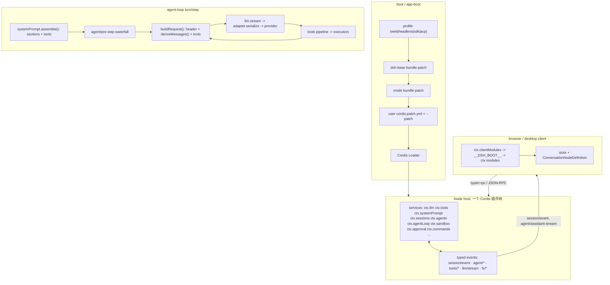

# 03 · DeepSeek Harness（DSH）源码研究：插件化架构与高缓存命中

> 仓库：`repos/dsh`（deepseek-ai/deepseek-harness，MIT），检出 commit `ce7073d51254c26cd63b22a60835b8f948deb447`（2026-10-30 00:13 +0800，Merge PR #7552）。
> 本地 `D:\dsh\gui\resources\app.asar` = 182,766,714 B，asar header 4,760,404 B。**本报告结论取自 GitHub 源码副本**；未解析本地 asar（header 4.7 MB、内含完整 node_modules，无增量价值，且本地包可能更新，见 §8）。
> 证据分级：`[源码]` 行号可直接核对；`[文档]` 仓内 README / docs / .agents Agent Note（仓内成文契约，非外部网页）；`[推断]` 我的归纳，仓内无直接断言。

---

## 0. TL;DR

| 问题 | 结论 | 强度 |
|---|---|---|
| 插件协议 | 三种形态并存：Cordis `Service` 子类（默认导出）、函数插件（`name`/`inject`/`Config`/`apply`）、纯配置行（bundle 的 `cordis.patch.yml`）。清单字段是 npm `package.json` 的 `dsh.bundle` / `dsh.profile` / `dsh.client` | [源码] |
| 扩展点 | 全部是 Cordis service + 类型化事件，无特权内核；tool / command / UI slot / LLM adapter / prompt section / runtime context / session event / agent hook 八类，见 §2.4 | [源码][文档] |
| 高命中的根 | **不是"做了缓存优化"，而是让"模型可见"成为会话日志的纯函数投影**：日志只追加 → 投影只追加 → 请求是前一步请求的 append-extension。前缀稳定是这条不变式的**推论** | [文档]（Agent Note 原文）|
| 请求分区 | `system`（provider 顶层槽，来自 surface 节点 0）→ `tools`（顶层数组，字典序/toolOrder）→ `messages`（派生历史）→ 尾部 runtime-context 快照。侧信道（遥测、插件清单、会话日志上传）走 body 扩展字段，**不进 prefix** | [源码] |
| 稳定前缀 4 条硬机制 | ① 消息对象深冻结 + 跨请求共享 identity；② 头部变了才写 `request/header`；③ 易变上下文以"追加快照 + supersedes"进 history；④ 工具集变化走 `toolHistory` + `developer/message` + `defer_loading` | [源码] |
| 失效触发器 | 压缩替换、system 节点原地替换、真实 tool schema/config 变更、模型路由切换、进程重启漂移。文档逐条承认并计量 | [源码][文档] |
| 命中观测 | 每 attempt 的 `cacheReadTokens`（DeepSeek `cache_read_input_tokens`）→ turn 级精确聚合 → UI 命中率 = cacheRead / (uncached + cacheRead + cacheWrite)；另有 with-key e2e 硬断言 | [源码] |
| 权限/沙箱 | 三档 mode（read-only / workspace-write / danger-full-access）× 两档 approval policy（ask / never）× preset；沙箱策略**按每次调用**携带，fail-closed | [源码] |
| Team | 任务板是 Lead 日志上的 DAG（CAS revision、依赖环校验）；write scope 仅 **advisory 重叠告警**，不是锁；spawn 子代理继承父 cwd（共享文件系统）但权限不可扩宽 | [源码] |
| SDK/运行时 | turn → step → 一次模型请求 + 工具批；流式 chunk 组装为不可变 message；失败 attempt 落 `assistant/attempt` 但不进模型历史（不破前缀） | [源码] |

---

## 1. 证据基线

| 项 | 值 |
|---|---|
| 仓库根 | `repos/dsh` |
| commit | `ce7073d5` master（浅克隆，仅此一代） |
| 包布局 | `packages/<group>/<pkg>/`，52 个 group（core/llm/session/sandbox/subagent/compaction/context/client/...） |
| 本地 asar | 182,766,714 B；未使用（见 §8） |
| `vendor/` | 检出中**不存在**（Test-Path → False）；Cordis 框架源码不在本次证据范围，只用 `docs/cordis-primer.md` 与各包用法取证 |

架构一句话（`docs/architecture.md:9`，[文档]）："Cordis is the framework under dsh: plugins contribute services, typed events, and reversible effects to a shared context. Every part of the product is a plugin, including the model adapter, the tool registry, the session log, and the agent loop itself, so each is replaceable from configuration."

---

## 2. 插件化架构

### 2.1 三层组合：profile → bundle → patch（全部是 YAML 行 + 代码）

`docs/architecture.md:15-27` [文档]：

- **profile**：Harness home 里的命名组合，列出堆叠的 bundle、外挂插件、用户的 `cordis.patch.yml`；出厂模板 `web` / `headless` / `sdk` / `sdk-minimal` / `acp`。
- **bundle**：Cordis 配置行 + 它们挂载的代码的分发格式；每层插入的行仍可被上层 patch。
- **patch 层序**：profile 的有序 bundle → profile 的 `cordis.patch.yml` → home patch → `--patch` overlay。**patch 按 row id 整行替换 config，或插入新行**。

清单字段（都在 `package.json` 的 `dsh` 下）：

| 清单字段 | 语义 | 证据 |
|---|---|---|
| `dsh.bundle.patch` | 该包是 bundle，指向 patch 文件 | `packages/bundle/base/package.json:31-35` [源码] |
| `dsh.profile.bundles` | 该包是 profile 模板，列出 bundle 顺序 | `docs/architecture.md:21` [文档] |
| `dsh.client` | 该包有浏览器半边（`platform: web`、`inject` 包名依赖、`external` 模块请求） | `packages/client/ui-workspace/package.json:29-48` [源码] |

`dsh-base`（`packages/bundle/base/cordis.patch.yml`，534 行）是 `web/headless/sdk/acp` 共用第一层：模型适配器、工具、持久化、沙箱与审批策略、设置、凭据、遥测。**第 12-13 行显式声明**：

```yaml
# Row order carries no load semantics (activation is service-availability
# driven); the grouping is for readers.
```

—— 行序不承载加载语义；**激活顺序由 service 可用性驱动**（`packages/bundle/base/cordis.patch.yml:12-13` [源码]）。

### 2.2 插件协议的三种形态

| 形态 | 结构 | 实例 |
|---|---|---|
| Service 子类（默认导出） | `class X extends Service` + `static Config`（schemastery）+ `static inject` + `[Service.init]`；构造函数 `super(ctx, 'key')` 认领 `ctx.key` | `packages/core/system-prompt/src/index.ts:436-439`；`packages/interaction/user-approval/src/index.ts:167-181` |
| 函数插件（具名导出） | `export const name` + `inject` + `Config` + `apply(ctx, config)`；**无 default export**（混用会让 Loader 丢弃命名空间，`packages/AGENTS.md` 明文） | `packages/context/time-context/src/index.ts:32-63,133`；`packages/llm/llm-retry/src/index.ts:21-24` |
| 纯配置行 | `- id / name / config / disabled: !!js ...`，`config` 由插件 `Config` 校验 | `packages/bundle/base/cordis.patch.yml:15-22,240-277,509-519` |

依赖注入语义（`docs/cordis-primer.md:9-13` [文档]）："Declare service dependency via `inject`. A plugin that names required services waits until those services exist, so load order is expressed through service requirements rather than manual boot sequencing."

可选服务用 `ctx.get(name)` 而不用 `ctx.<name>` 属性代理（代理对拓扑敏感）——`packages/AGENTS.md` 规则；源码例：`ctx.get('approval')`（`packages/shell/tool-bash/src/index.ts:241`）。

### 2.3 生命周期：注册即 effect，卸载即回滚

`docs/cordis-primer.md:13,41-45`：prompt section、tool schema、adapter、provider、listener 全部经 `ctx.effect()` / `ctx.on()` 安装，"reload and teardown unwind them predictably"。

代码三段式：

1. **构造**：认领 `ctx.key`（`super(ctx, 'approval')`，`packages/interaction/user-approval/src/index.ts:176-178`）。
2. **`[Service.init]` 异步初始化**：注册 projection / prompt / listener；并先检查 fiber 是否已卸载（`if (this.ctx.fiber.uid === null) return`，`:180-189`）。注释原文："Registration can finish after an unload has started. Do not add effects then."
3. **注册返回 disposer**：`packages/core/tools/src/index.ts:325-344` 的 `setExecutor` 用 `this.ctx.effect(function* () { ... })` 原子安装多段注册；`packages/core/system-prompt/src/index.ts:485-493` 的 `section()` 同样走 `ctx.effect`。

**Loader / HMR**：`packages/boot/app-boot/src/index.ts:3-5,17`——`.env` → fail-loud Loader guard → 解析配置路径 → 驱动 Cordis `Loader` 直到树 settle；`packages/bundle/base/cordis.patch.yml:27-32` 给 base 开 config-only HMR。

### 2.4 扩展点全表

`docs/architecture.md:142-169` [文档] + 源码锚点：

| 想加 | 机制 | 源码锚点 |
|---|---|---|
| 模型 provider | `ctx.llm.registerAdapter(providers, adapter)` | `packages/llm/llm/src/index.ts:401-417` |
| 模型可见工具 | `ctx.tools.register(definition)`（schema 随 prompt assembly 进请求） | `packages/core/tools/src/index.ts:128`；`packages/core/tools/src/contracts.ts:26-39` |
| 人命令（不走模型 turn） | `ctx.commands.register(definition)` | `packages/interaction/commands/src/index.ts:61-64,285-291` |
| 系统提示词片段 | `ctx.systemPrompt.section({name, order, text})` | `packages/core/system-prompt/src/index.ts:485-496` |
| 易变上下文 | `ctx.systemPrompt.context({name, order, text})` → 以 user 消息快照进 history | `packages/sandbox/sandbox-policy/src/index.ts:174-186` |
| 请求/工具/turn 拦截 | `agent/pre-step` / `agent/request` / `llm/stream` / `tools/pre-execute`、`tools/execute`、`tools/post-execute` | `packages/core/agent-loop/src/agent.ts:630-633`；`docs/architecture.md:106` |
| 工具执行策略（超时/重试/守卫/审批） | `tools/*` waterfall 上的包装插件 | `docs/tool-execution-pipeline.md:13-27` |
| UI（Web Chat 卡片） | `ConversationNodeDefinition` + keyed renderer + slot | `packages/client/ui-conversation/src/client/contract/conversation.ts:213`；`packages/client/ui-slots/src/index.ts:1021` |
| 会话状态（可持久化） | 扩展 `SessionEventMap`，从日志回放 | 各包 `declare module '@deepseek-ai/dsh-session/types'`，如 `packages/interaction/user-approval/src/index.ts:31-47` |
| 单 agent 能力裁剪 | `agent.ctx` 作用域注册 / agent preset / `tools.restrict()` | `packages/core/tools/src/index.ts:182` |

**工具 schema 的"可序列化面"被显式收窄**：`packages/core/tools/src/contracts.ts:62-69` 原文 "it is NEVER sent to the model — `schemas()` whitelists only name/description/parameters"；实现 `packages/core/tools/src/index.ts:309-318` 把可见定义投影到白名单字段并深拷贝，执行回调、presentation、timeoutMs、并发分类器**一律不进模型**。

### 2.5 host ↔ plugin / host ↔ client 通信

| 链路 | 机制 | 证据 |
|---|---|---|
| 同进程 host ↔ plugin | 直接 service 方法调用（同类型边界不校验）+ 类型化事件（`emit/waterfall/parallel/serial/bail`） | `docs/cordis-primer.md:15-27,43` |
| 事件三类域 | session 事件（durable）/ agent 事件（`agent/*`，带 live Agent）/ capability 事件（`fs/*`、`tools/*`、`telemetry/*`） | `docs/architecture.md:67-77` |
| host（Node）↔ 浏览器插件 | `ctx.clientModules` 扫描声明 `dsh.client` 的包 → 组装 `window.__DSH_BOOT__` 入口图 → `/plugins` 下发版本化 combo 脚本 → 浏览器半边 `ctx.modules` 懒加载物化 | `docs/subsystems/client-modules.md:5,11`；`WebBootEntry` 类型同文 13-39 |
| 远端 RPC | Typert gateway（方法级 ACL、`rpcId` 双向） | `packages/bundle/base/cordis.patch.yml:46-58`；`packages/interaction/commands/src/index.ts:16` |
| 出进程 SDK | stdio JSON-RPC：`session/query`/`session/prompt`/`session/resume`，流式 `session.event` 通知 | `packages/sdk/server/README.md:12,28-34` |

### 2.6 "权限声明"在插件层长什么样

DSH 没有插件 manifest 级权限清单（无 VS Code 式 `permissions` 字段）。权限来自四层叠加：

1. **依赖声明**：`inject` 声明需要的 service → 没有就 PENDING，拿不到能力（`docs/cordis-primer.md:11`）。
2. **配置声明**：`static Config` / `export const Config` 在加载期校验；"部署可变的选择必须是 Config 字段，协议常量与安全不变量固定"（`AGENTS.md` "No hardcoded tunables in plugins"）。
3. **作用域**：`ScopeKey` / agent preset / `tools.restrict()` 把注册限定到单个 agent（`packages/core/tools/src/index.ts:182`）。
4. **运行时策略服务**：`ctx.approval`（`'ask' | 'never'`）与 `ctx.sandboxPolicy`（三档 mode）——见 §4。

### 2.7 架构图



ASCII 版请求分区（本报告最重要的一张图）：

```text
┌─────────────────────────────── provider 请求 ───────────────────────────────┐
│ [Z0] system   : 来自 surface 节点 0 的 system/message（顶层 system 槽）      │ ← 极少变，变则全段失效
│ [Z1] tools[]  : schema 白名单投影，字典序或 toolOrder；defer_loading         │ ← 变化 = 从第一个 schema 起失效
│ [Z2] messages : 派生历史（append-only）+ 尾部 developer/message(tool 增删)   │ ← 只追加 = 前缀保留
│               + 尾部 user/message(runtime context 快照, "supersedes earlier")│
│               + 尾部 user/message(time 读秒, 默认 10min 节流)                │
│ [Z3] 侧信道   : x-deepseek-harness-* header / dsh_session_log / dsh_plugin_* │ ← 零 token、零 prefix 影响
└──────────────────────────────────────────────────────────────────────────────┘
```

---

## 3. 高缓存命中（重点）

### 3.1 设计原点：一句可检验的不变式

`.agents/notes/implemented/architecture/2026-07-05-reconstructable-requests.md:17` [文档]：

> "**Model-visible ⟺ durably referenced.** Anything that reaches a model request must be reconstructable from the session log and the immutable content-addressed objects it references. The checkable consequence: anyone holding the log, its referenced attachment objects, and the pinned code version reconstructs every loop request byte-for-byte."

同文 `:19` 是本任务最该抄的一句：

> "**Prefix-cache stability is corollary #1, not the headline**: an append-only log projected by a per-node pure function yields requests that are append-extensions of their predecessors whenever the header is unchanged — stability is emergent, not managed."

即：**没有一层独立的 provider prompt-cache 管理器**（`deriveMessages()` 的派生消息缓存是投影缓存，不是缓存策略层）。缓存命中是"日志只追加 + 投影是纯函数"的涌现结果。这条设计把"别破坏缓存"从纪律问题变成了类型/接口问题（见 §3.4 ⑤ 的"不可表示"手段）。

### 3.2 真实请求装配链路（不是 `llm/assembler.ts`，那是流式 chunk 组装）

| # | 步骤 | 代码 |
|---|---|---|
| 1 | 开 turn，claim inbox 批次 | `packages/core/agent-loop/src/agent.ts:327-347` |
| 2 | `tools.resolve()` 得到本 step 可见工具集 | `agent.ts:292` → `packages/core/tools/src/index.ts:264` |
| 3 | `systemPrompt.assemble()`：sections + contexts + tools 一并装配（**每 step 一次**） | `agent.ts:294` → `packages/core/system-prompt/src/index.ts:621-696` |
| 4 | `agent/pre-step` waterfall（可改写/拒绝本轮消息） | `agent.ts:296-306` |
| 5 | `agent/request` 只允许改 call config（provider/model/effort 已冻结） | `agent.ts:630-640` |
| 6 | `prepareCall()` 绑定适配器，得到 route 能力（`systemPromptUpdate`/`toolUpdate`/`contextWindow`） | `agent.ts:643-651` |
| 7 | 刷新 runtime facts → 渲染 prompt → 按 route 能力决定原地替换或尾部追加 → 追加 user 消息 | `agent.ts:446-477` |
| 8 | `buildRequest()`：canonicalHeader → 必要时写 `request/header` → 写 tool 增删 `developer/message` → `deriveMessages()` → 冻结 | `agent.ts:655-744` |
| 9 | `llm.stream()`：waterfall `llm/stream` → 适配器前置投影 → `adapter.serialize()` | `packages/llm/llm/src/index.ts:1068-1122,1174-1184` |
| 10 | DeepSeek 适配器序列化：`system` 顶层槽 / `tools[]` / `messages[]` | `packages/llm/llm-deepseek/src/serialize.ts:57-168` |

**第 8 步原文摘录**（`packages/core/agent-loop/src/agent.ts:665-691`）：

```ts
const surfaceGeneration = session.surface.contentGeneration
const header = canonicalHeader({
  config,
  ...preparedCall === undefined ? {} : { adapterDefaults: preparedCall.adapterDefaults },
  ...tools.length > 0 ? { tools } : {},
})
const baseline = this.session.requestHeader()
const startsSeries = startsRequestSeries
  || this.requestSurfaceGeneration !== surfaceGeneration
let headerSeq: SessionSeq | undefined
if (!this.requestHeaderLogged) {
  headerSeq = this.session.append('request/header', {
    header,
    reason: baseline === undefined ? 'initial' : 'resume',
    ...startsSeries ? { startsSeries: true } : {},
  }).seq
  this.requestHeaderLogged = true
} else if (baseline === undefined || !headerEquals(baseline, header)) {
  headerSeq = this.session.append('request/header', {
    header, reason: 'change', ...startsSeries ? { startsSeries: true } : {},
  }).seq
} else if (startsSeries) {
  this.session.append('request/header', { header, reason: 'series' })
}
```

三点：**①** 只有 `headerEquals` 为假才写新快照（字段级比较：config + adapterDefaults + tools 逐项 `JSON.stringify`，`packages/core/session/src/request-header.ts:32-52`）；**②** header 永远是**全量快照**，不是 delta（"A custom header-delta codec … rejected"，`Agent Note :44`）；**③** 未变却开始新系列时只写 `reason: 'series'`，请求不变。

**同函数末尾的冻结**（`agent.ts:726-743`）：

```ts
deepFreeze(header)
const boundaryMessages = session.deriveMessages()
for (const message of boundaryMessages) {
  if (this.frozenMessages.has(message)) continue
  deepFreeze(message)
  this.frozenMessages.add(message)
}
Object.freeze(boundaryMessages)
const request = markAgentLoopRequest(Object.freeze({
  ...header.config,
  messages: boundaryMessages,
  toolHistory: session.toolHistory(),
  ...header.tools !== undefined ? { tools: header.tools } : {},
  sessionId: this.session.id,
  signal,
}))
```

—— `frozenMessages` 是**跨请求复用的冻结证据**：同一 Message 对象在相邻请求里是同一引用、不可变，所以"序列化结果相同"不依赖比较逻辑，而是类型保证。`packages/core/agent-loop/tests/request-freeze.spec.ts:101-127` 断言第二次请求 `messages[0]` 与第一次同引用，且 `JSON.stringify(first.messages)` 在后续 turn 后不变。

### 3.3 分区与顺序：顺序本身就是缓存设计

**(a) system prompt 的 section 顺序集中、数值化**（`packages/core/system-prompt/src/index.ts:136-172`）：

```ts
const SECTION_ORDERS = {
  HARNESS_IDENTITY: -1000,
  DEPLOYMENT_PERSONA_PREFIX: 0,
  PLAN_POLICY: 500, TEAM_POLICY: 600, PTC_ONLY: 800, FILE_REFERENCE: 900,
  TOOL_BASH: 1000, TOOL_PWSH: 1010, TOOL_READ: 1100, TOOL_WRITE: 1200, TOOL_EDIT: 1300,
  ... TOOL_SUBAGENT: 2800, TOOL_REPORT: 2900, TOOL_COMPUTER_USE: 3000, MCP_SERVERS: 3100,
  TOOLS_SDK: 5000, DELIVERABLE_FILE_REFERENCES: 9000, STRUCTURED_OUTPUT: 9900,
  // Local paths and endpoints follow reusable instructions.
  HARNESS_SOURCE: 10000, WEB_SURFACE: 10100, DEPLOYMENT_PERSONA_SUFFIX: 10200,
} as const
```

排序函数是**码元比较**（`:249-257`）："Code-unit name comparison — locale-independent, so the order is identical on every machine." 同 order 再按名字排序 → 跨机器、跨 locale 字节一致。

**(b) 易变上下文与稳定 instruction 分离**（`:177-186` 的 `CONTEXT_ORDERS`），注释直接写了缓存动机：

```ts
const CONTEXT_ORDERS = {
  WORKING_DIRECTORY: 100, SANDBOX_POLICY: 110, APPROVAL_POLICY: 115,
  SUBAGENT_DELEGATION: 120, TEAM_IDENTITY: 125,
  // Process-specific paths and endpoints stay out of the cached system prompt.
  HARNESS_SOURCE: 200, WEB_SURFACE: 210,
}
```

**(c) 工具数组排序**（`:228-247`）：默认字典序；`toolOrder` 可显式排序但必须包含一次 `<unlisted-tools>` 占位，未列出的工具在该位置按字典序插入；列了未注册的名字 → **fail loud**。工具名 `<unlisted-tools>` 被保留（provider 返回它即报错，`:234-237`）。

**(d) runtime context 是"尾部快照"，不是 system 改写**（`packages/core/agent-loop/src/agent.ts:463-477`）：

```ts
if (firstAttempt) {
  for (const message of decision.messages) {
    if (message.source.kind === 'runtime-context') {
      if (context !== undefined && !contextAdmitted) {
        this.session.append('user/message', context, { surfaceOp: 'append' })
        contextAdmitted = true
      }
    } else {
      this.session.append('user/message', message, { surfaceOp: 'append' })
    }
  }
}
if (context !== undefined && !contextAdmitted) {
  this.session.append('user/message', context, { surfaceOp: 'append' })
}
```

恒为 `surfaceOp: 'append'`。文本由 `joinContextSections` 加固定前缀（`packages/core/system-prompt/src/index.ts:321-325`）：`Current runtime context. This snapshot supersedes earlier runtime-context snapshots.`——"后面的快照覆盖前面"是**语义**覆盖，物理上是 append。这正是缓存友好写法：旧快照留在 prefix 里继续命中。

**(e) 去重：内容没变一个字节都不写**（`packages/core/agent-loop/src/runtime-context.ts:151-168`）：

```ts
project(current: string, sections: readonly ContextSnapshotSection[]): UserMessage | undefined {
  if (this.retained === undefined && current.length === 0) return
  const snapshot = current.length === 0 ? CLEARED : current
  if (this.retained?.text === snapshot) return
  ...
}
```

**(f) 易变源头的节流**：`time-context` 默认 10 分钟才注入一次（`packages/context/time-context/src/index.ts:55` 默认 `refreshIntervalMs ?? 600_000`；`:209-213` 提前 return）。如果它每 step 注入读秒，命中率立刻坍塌。

**(g) DeepSeek 适配器最终序列化形状**（`packages/llm/llm-deepseek/src/serialize.ts:151-168`）：

```ts
const system = [options.system, historySystem].filter(Boolean).join('\n\n')
return {
  model: options.model, stream: true, messages,
  max_tokens: ..., thinking: {...}, ...(effort === 'off' ? {} : { output_config: {...} }),
  ...system.length === 0 ? {} : { system },
  ...options.stop === undefined ? {} : { stop_sequences: options.stop },
  ...options.tools === undefined ? {} : { tools: options.tools.map(tool => ({ name, description, input_schema, ...defer_loading })) },
}
```

`system` 是**独立顶层字段**（不在 `messages` 里）；`inHistory` 路由的 system 更新被塞进 `messages` 的 user/assistant 之间（`:106-116,85-89`）——这是"能追加就不替换"的 wire 级落地。

### 3.4 稳定前缀的六条硬机制

| # | 机制 | 防的问题 | 证据 |
|---|---|---|---|
| ① | 日志 append-only + `deriveMessages()` 逐节点缓存投影（纯尾部增长 O(new)，替换/投影重建） | 重复投影产生不等价字节 | `packages/core/session/src/index.ts:974-1020` |
| ② | 投影结果深度冻结且跨请求共享 identity；每次返回新数组、旧数组不增长 | 插件/监听器在请求构造后改历史 | `session/src/index.ts:991-997`；`agent.ts:728-734` |
| ③ | 头部（config+tools）只在**变化时**写全量 `request/header` | 每 step 无谓改变请求 envelope | `agent.ts:675-691`；`session/src/request-header.ts:43-52` |
| ④ | 易变上下文 → 尾部 user 快照（supersedes earlier）+ 内容相同则不写 + 时间源 10min 节流 | 把 cwd/沙箱/审批策略塞进 system 导致整体失效 | `runtime-context.ts:157-168`；`system-prompt/src/index.ts:183`；`time-context/src/index.ts:55,209-213` |
| ⑤ | **"不可表示"**：`agent/request` 改 provider/model/effort 直接抛错；请求 `Object.freeze`；冻结后原地改抛 `TypeError` | 监听器"合法地"毁掉前缀 | `agent.ts:635-640`；`request-freeze.spec.ts:204` |
| ⑥ | 工具集变化走 `toolHistory` + `developer/message` + `deferLoading`；route 支持 `toolUpdate` 时**不重写声明列表** | 新增一个工具就重排 `tools[]` → 从第一个 schema 起全部 miss | `packages/llm/llm/src/content.ts:381-491`；`agent.ts:692-706`；`llm/src/types.ts:442-451` |

**第 ⑥ 条关键代码**（`packages/llm/llm/src/content.ts:396-411`）：

```ts
switch (mode) {
  case 'in-history':
    // Removal blocks disable tools without discarding their historical definitions.
    return declarations
  case 'addition-only': {
    // Without removal support, the declaration list must omit inactive tools.
    const activeNames = new Set(tools?.map(tool => tool.name))
    for (const name of declarations.keys()) {
      if (!activeNames.has(name)) declarations.delete(name)
    }
    return declarations
  }
}
```

配套模型可见语义：工具增删写成 `developer/message` 的 `tool-addition`/`tool-removal` 块（`agent.ts:700-704`），wire 上是 `tool_addition`/`tool_removal` 引用（`serialize.ts:91-101`），声明本体用 `defer_loading: true` 延后生效（`content.ts:388-393`）。

**第 ⑦ 条补充：升级也不能动老会话的前缀**。`packages/context/harness-dev-context/README.md:36` [文档] 记录了一个很硬的约束：早先版本把安装根与 GUI URL 写进了 system prompt；当某会话最新的非空 system prompt 仍包含那些确切段落时，插件会**逐字重复旧段落（连旧值一起）**，使升级、端口变化、checkout 迁移之后该会话的 prompt 仍 byte-identical，当前值改由 runtime-context 行提供（"Text that only resembles an earlier paragraph receives the current guidance"）。这是"缓存契约优先于事实新鲜度"的极端例子——新信息可以追加，历史字节不许改。

### 3.5 会打破缓存的事件清单

| 触发 | 影响面 | 代码/文档 |
|---|---|---|
| 压缩（compaction）替换旧区间 | 从第一个被替换 token 起失效；区间前前缀仍可复用 | `compaction-basic/README.md:243-245`；`Agent Note :54` |
| system prompt 真变（原地替换节点 0） | **全段**失效（从第一个 token 起） | `agent-loop/README.md:164` |
| system 变但 route 支持 `in-history` | 只在尾部 append，前面全保留 | 同上 `:164`；`runtime-context.ts:100-107` |
| 保留的工具定义变化 / 重建声明 | 从第一个改动 token 起失效 | `agent-loop/README.md:164` |
| provider/model/effort 切换（`change` header） | 新路由无缓存 | `agent.ts:683-691`；`request-header.ts:43-52` |
| resume 时 envelope 漂移（`resume` 快照不同） | 漂移点起失效 | `agent.ts:675-681` |
| 沙箱/审批策略切换 | **不**失效（尾部快照） | `sandbox-policy/README.md:144-146`；`user-approval/src/index.ts:187-189` |
| 工具调用失败/取消的补齐结果 | **不**失效（append） | `agent-loop/README.md:192,206` |
| 遥测/插件清单/会话日志上传 | **不**失效（body 扩展字段，在 messages/tools/system 之外） | `docs/deepseek-llm-api-wire-extensions.md:7` |

`Agent Note :52` 原文：

> "What still costs full price at the provider is inherent and logged: compaction …, a real prompt change (`system/message` replacement of surface node 0), a real tool or config change (`request/header` with reason `change`), or a process boundary with drift …"

—— **"必然全价"的清单被显式枚举**，而不是假装能全命中。

### 3.6 压缩 / 裁剪策略（按代价递增）

| 层 | 做什么 | 调模型 | 缓存影响 | 证据 |
|---|---|---|---|---|
| spill（输出外溢） | 超大工具输出落盘，请求里只留句柄 | 否 | 不改已有前缀 | `packages/bundle/base/cordis.patch.yml:410-416`（`maxInlineTokens: 12500`） |
| tool-result-pruner | 压缩前先按字符预算裁头尾 | 否 | 单节点 replace | 同上 `:424-429`（`thresholdChars: 8192`、`headChars: 4096`、`tailChars: 1024`） |
| image-offload | 图片预算超限时把最旧图片换占位符并重试 | 否 | 单点 replace + 新 series | 同上 `:431-434` |
| compaction-basic | 把最老的平衡区间换成 `<compacted-summary>` checkpoint | **是**（1 次额外请求） | 替换区间起点起失效 | `compaction-basic/README.md`（`thresholdRatio 0.8` / `retainRatio 0.16` / `headroomTokens 65536`） |

**压缩请求本身也缓存友好**（`compaction-basic/README.md:243-245` [文档]）：

> "The replayed system prompt, tools, and shadowed-region messages match the conversation's last routed request byte-for-byte, so the provider's warm prefix cache is reused up to the trailing instruction; only that instruction, and the summary output, is uncached. Routing the summarizer to a different provider/model, or compacting a non-head range, forgoes this reuse."

实现要点（同包 "Understand the implementation"）：summarizer 用 `ctx.llm.stream()` 直连、把 surface 节点 0 的 system 消息作为 `messages[0]` 重放、带上 header 的 tools、末尾追加固定 instruction；`GenerateOptions.purpose = 'compaction'`（DeepSeek 侧映射成 `x-deepseek-harness-compact: 1` 头，`docs/deepseek-llm-api-wire-extensions.md:29`）。另外压缩区间**永远从第一个非 `system/message` 的 surface 节点开始**，所以 system 永不被 shadow（同 README）。

### 3.7 命中观测与指标

**数据源**：DeepSeek 适配器把 wire 字段映射成内部 usage（`packages/llm/llm-deepseek/src/translate.ts:34-43`）：

```ts
const keys = { input_tokens: 'inputTokens', output_tokens: 'outputTokens',
  cache_read_input_tokens: 'cacheReadTokens', cache_creation_input_tokens: 'cacheWriteTokens' } as const
```

`totalTokens = input + output + cacheRead + cacheWrite`（`:159`）——即 `inputTokens` 只是**未命中**部分（与 OpenAI `prompt_tokens` 含 cached 的口径不同，横向比较要注意；[推断]，由字段语义推出）。

**turn 级精确聚合**（`packages/llm/token-meter/src/turn-usage.ts:178-274`）：折叠 `turn/start → step/start → assistant/attempt|assistant/message → (llm/retry) → step/end → turn/end`；任何缺失边界、非法计数、矛盾 total 都让**整个 disclosure 变 undefined**（"No attempt is inferred from a usage sample"，`:169-177`）。可选桶仅在**每个** attempt 都报了才出现（`:133-138`）。

**命中率公式**（两处独立实现，口径一致）：

- `packages/experimental/client-ui-stats/src/client/stats-totals.ts:18-26`：`context = uncachedInput + cacheRead + cacheWrite`，`cacheHit = cacheRead / context`。
- `packages/client/ui-chat/src/client/chat/token-format.ts:61-76`：`promptTokens - cacheReadTokens` 为 miss。
- UI：`StatsPills.tsx:108-119,296-335`、`TurnUsagePanel.tsx:34-86`。

**回归门禁**：`packages/core/agent-loop/tests/request-cache.e2e.ts`（with-key，无 key 自跳过）——两轮对话 + 多步工具调用，断言**第一次以外每个 `assistant/message` 的 `cacheReadTokens > 0`（`:97-99`）；`:16-23` 写明测试意图："prefix stability is corollary #1 … 每步 usage 是 cache 行为的 production observable；这是重建性不变的测量层"。`:26-27` 还给出**缓存块粒度 64 tokens**（"64 tokens from the very first request"）——仓内唯一提到块粒度的位置，是注释断言而非代码常量，[文档] 级。

### 3.8 "为什么能高命中"——因果链

1. **单一真源 + 纯函数投影**：请求每字节都来自 `deriveMessages()` 对日志的投影；投影按 surface 节点逐条缓存（`session/src/index.ts:1008-1019`）。第 N 与第 N+1 步共享同一批 Message 对象（冻结不可变），序列化后自然 byte-identical。
2. **追加是默认，替换是例外**：用户/助手/tool 结果/runtime 快照/审批策略/工具增删通知全部 `surfaceOp: 'append'`。替换只发生在压缩、prompt 真变、图片降级等确实改了模型应看内容的场合。
3. **头部隔离**：system+tools 是独立区，被"只在变时写快照 + 全量快照 + route 支持时改成尾部 append"三重保护；schema 白名单投影确保非模型字段永远进不去。
4. **易变性的物理下推**：cwd、沙箱策略、审批策略、子代理委派、开发上下文、时间一律进 runtime-context 尾部快照，且内容不变就不写、源头再节流。system prompt 在一个会话里几乎是常量。
5. **能力协商而非硬编码**：`systemPromptUpdate: 'in-history'` / `toolUpdate: 'in-history' | 'addition-only'` 由适配器在 `prepareCall()` 声明（`llm/src/types.ts:434-451`）。支持的 provider 把变更往后放，不支持的才退化成原地替换——**缓存友好度是路由能力**。
6. **测量闭环**：per-attempt usage → turn 聚合 → UI 命中率 → with-key e2e 断言。任何偷偷降低前缀稳定性的改动先在 e2e 掉 hit，再在 UI 被看到。
7. **制度化的文档契约**：仓规要求每个包 README 必写 "Model Experience" 的 "Token effect" 与 "**KV Cache effect**"（`packages/AGENTS.md`："Package READMEs document model, token, and KV-cache effects using the canonical Model Experience format"）。"这个改动会不会伤缓存"在每个 PR 里是必答项。

**没有做的事**（避免过度归因）：DSH 自己的 DeepSeek 适配器**不发** `cache_control` 断点（全仓 grep `cache_control` 只命中 `llm-pi-ai` 的 catalog 与 docs/config-catalog），依赖 DeepSeek 服务端自动前缀缓存；只有走 `llm-pi-ai`（Anthropic/OpenAI-compat）时才由 pi-ai 按 `cacheControlFormat: 'anthropic'` 与 `cacheRetention: none|short|long` 配置生成显式 marker（`packages/llm/llm-pi-ai/src/catalog.ts:142-151,255-267`、`src/config.ts:150-160,340`、`src/adapter.ts:150`）。[源码]（配置面）+ [推断]（marker 实际落点由上游 pi-ai 决定）。

### 3.9 可复用的"缓存友好上下文布局"规则（10 条）

1. **把请求当"日志的纯函数"**，不是"每步重新拼装的字符串"。
2. **分区固定**：`[system][tools][history][volatile-tail]`；任何每轮会变的东西放最后一区。
3. **system 区只放稳定指令**：路径、端口、时间、权限模式、进度一律外置。
4. **尾部快照用 "supersedes earlier" 语义**，物理 append；不回头改旧消息。
5. **尾部快照做值比较**，相同就不写；对高频源再加时间/事件节流。
6. **确定性序列化**：section 用显式数值 order + 码元比较；工具用显式 order 或字典序。
7. **schema 白名单投影**：运行时元数据（超时、并发、UI）单独存放，进不了 prefix。
8. **工具/能力变更往后放**：声明全量 + 增量激活（`defer_loading` + 历史 developer 通知）；provider 不支持才重写数组。
9. **变更留全量快照、不留 delta**：请求 envelope 全量记录 + 字段级比较，可离线重建；delta 会引入"窗口外无法重建"的第二套编解码。
10. **把命中率做成回归指标**：per-attempt cache-read tokens → 聚合 → 断言"第一次之后必须 > 0"。

---

## 4. 权限与沙箱

### 4.1 三层模型

| 层 | 取值 | 作用点 | 证据 |
|---|---|---|---|
| sandbox mode | `read-only` / `workspace-write` / `danger-full-access` | 文件写入边界（进程 & fs 工具） | `packages/sandbox/sandbox/src/index.ts:24-33` |
| approval policy | `ask` / `never` | 需人批准的動作；`never` = 不提问、确定性拒绝 | `packages/interaction/user-approval/src/index.ts:58-76` |
| preset | 三个预设 = (mode, policy) 组合 | 用户一次切换两件事 | `packages/bundle/base/cordis.patch.yml:264-277` |

出厂默认（`packages/bundle/base/cordis.patch.yml:240-262`）：`sandbox-policy.mode = process.env.DSH_PERMISSION_MODE ?? 'workspace-write'`、`workspaceRoot = process.cwd()`、approval `policy = (mode === 'danger-full-access') ? 'never' : 'ask'`。`danger-full-access` 配 `never` 是刻意的（无边界可守时不必再问）。

**fail-closed 语义**（`user-approval/src/index.ts:293-318`）：

- `never` 在**服务内部**、任何 listener 之前判定（`:301`；注释说明 listener 层 gate 不可靠，因为 `prepend: true` 可以插到 gate 前面）。
- 无 answerer / answerer 抛错 / 返回非法值 → `unavailable`（拒绝）。
- 只接受 `allowed-once`（一次性授权）。
- 审批对 `approval/asked` + `approval/decided` 必须被一个 open turn 包住，否则直接抛错（`:242-261`）——否则重载后会把裸事件当 crash-tail garbage。

### 4.2 工具调用路径（一次 bash 的完整决策链）

`docs/tool-execution-pipeline.md:13-27` [文档] 是本仓最清晰的流水线（语义节选）：

```text
model tool-call
  → tool/call 事件（执行前先落日志）
  → tools/pre-execute waterfall（hooks / permission / sandbox）
  → 注册的单调 guard（只 deny 或弃权；身份受保护）
  → ctx.approval 一次性提问（无 answerer = deny）
  → tools/execute waterfall（timeout / retry / metrics，环绕 dispatch）
  → 工具 body（fs/write-intent、fs/edit-intent 只对 tool-fs 生效）
  → projectContent → tools/post-execute（accept/block/replace/add context）
  → finalizeContent → tools/result → tool/result 事件
```

**权限升级（sandbox_permissions）**：模型可在工具入参里带 `sandbox_permissions` + `justification` 请求更宽权限，**执行前**必须过 `ctx.approval`（`packages/shell/tool-bash/src/index.ts:228-248`）：

```ts
return approveEscalation(
  { requestedMode: mode, justification, effectiveMode, subject: 'command' },
  { approver: ctx.get('approval'), agent: exec.agent, callId: exec.callId, toolName: 'bash', signal: exec.signal },
)
```

只有 executor 声明了沙箱（`ctx.shell.sandboxMode !== undefined`）才 advertise `ESCALATION_TARGETS`（`:207-212`）；composition 不完整在**工具插件加载期**抛错（"split composition fails at tool-plugin load"）。

### 4.3 写入边界与"两个执行世界一致"

`packages/sandbox/sandbox/src/roots.ts` 是 `workspace-write` 语义的**唯一归属地**：

```ts
export function workspaceWritableRoots(policy: SandboxExecutionPolicy): string[] {
  if (policy.mode !== 'workspace-write') return []
  return [...new Set([canonicalPath(policy.workspaceRoot),
    ...(policy.additionalWritableRoots ?? []).map(additionalRoot)])]
}
export function writableRoots(policy: SandboxExecutionPolicy): string[] {
  if (policy.mode !== 'workspace-write') return []
  return [...new Set([...workspaceWritableRoots(policy), canonicalPath('/tmp'), canonicalPath(tmpdir())])]
}
```

注释说明为什么必须共享（`:1-14`）：Seatbelt profile（进程沙箱）与 in-process fs fence（`dsh-fs-sandbox`）都从这里派生 allow-list，**否则会出现"write 工具写不了 /tmp 但 bash 能写"的不对称**。`additionalRoot` 还拒绝符号链接别名（`:30-45`），防止显式授权被重定向。

沙箱策略**按每次调用携带**（`packages/sandbox/sandbox/src/index.ts:69-80` 注释）："two consumers may confine under different policies at the same instant … and an approved escalated retry is a new call with a wider policy."；provider 不默认、不兜底，缺失即 `SANDBOX_UNAVAILABLE` 并**拒绝不受限执行**（`:139-152`，"silent unconfined passthrough is forbidden"）。

### 4.4 权限对模型的可见面（也是缓存设计）

策略切换**不改 system prompt**，而是追加一条快照。`packages/interaction/user-approval/src/index.ts:187-189` 原文注释：

> "The complete current value travels after retained history, so switching policy does not rewrite the stable system-prompt cache prefix."

模型看到的句子固定两条之一（`:73-81`）：`NEVER_SENTENCE`（"Approval prompts are disabled in this session: actions that require approval are rejected automatically — do not request sandbox escalation (do not set sandbox_permissions)."）与 `ASK_SENTENCE`。沙箱侧同理（`packages/sandbox/sandbox-policy/README.md:125-137` 列三种模式的模型可见文案，`:144-146` 给出 KV Cache effect："The stable system prompt remains byte-identical across mode changes. A changed full context snapshot is appended after retained history, preserving the prior cached prefix"）。

---

## 5. 多代理 / Team

### 5.1 spawn 与 fork（为什么 fork 不传模型参数）

`packages/bundle/base/cordis.patch.yml:375-394`：

```yaml
# Fork omits model-selection arguments for KV Cache reuse. Parent and child
# share the messaging tools; return guidance follows the inherited history.
- id: tool-subagent-fork
  name: '@deepseek-ai/dsh-tool-subagent'
  config: { provider: fork, toolName: subagent_fork }
```

—— fork 子代理**继承父会话日志前缀**（seed），复用父的 warm prefix；一旦允许传不同 model/effort，这次复用就作废。这是"缓存约束反向塑造 API 设计"的典型。

子会话持久元数据（`packages/subagent/subagent/src/child-agent.ts:135-154`）：继承 `parentHeader.cwd`（→ **共享文件系统/工作目录**）、`parentSession`（血缘）、`origin: 'subagent'`、`delegationDepth`（递归预算，必须跨持久化存活）、`agentPreset`（独立组合时）。

委派范围声明也是 runtime-context（`child-agent.ts:166-175`）："A runtime-context contribution rather than a system-prompt section, **so the deployment's system prompt stays uniform across parents and children**."（又一次缓存动机）

### 5.2 任务板：DAG + CAS + advisory write scope

`packages/experimental/agent-team/src/task-board.ts`（实验包）：

| 能力 | 语义 | 行号 |
|---|---|---|
| 创建 | 入 Lead 日志，`revision: 1`，`status: pending`；`subject ≤ 200`、`description ≤ 16_384` 字符 | `:44-69` |
| CAS 更新 | `expectedRevision !== current.revision` → `TEAM_TASK_STALE_REVISION` | `:115-120` |
| 权限 | claim/release/edit/set_dependencies/complete/reopen/delete 需 **owner 或 Lead**；`reassign` 仅 Lead | `:122-198` |
| 就绪判定 | `blockedBy` 全 completed 才 ready；claim 被阻塞 → `TEAM_TASK_BLOCKED` | `task-view.ts:24-26`；`task-board.ts:133-135` |
| DAG 校验 | 自环、重复 blocker、缺失/已删除 blocker、**环检测**（DFS visiting/visited） | `task-graph.ts:26-68` |
| 删除保护 | 仍被他人依赖 → `TEAM_TASK_HAS_DEPENDENTS` | `task-board.ts:189-198` |
| 写作用域 | 归一化为 workspace-relative 路径前缀，拒绝绝对路径/盘符/`..` | `validation.ts:26-34` |
| 重叠告警 | 仅当**另一任务 in_progress** 且前缀互相包含时给 `write scopes overlap with task-x` | `task-view.ts:14-16,43-49` |

**关键结论：write scope 是 advisory，不是锁。** `validation.ts:21-23` 的 JSDoc 原文："Normalize one workspace-relative path prefix **without treating it as a lock**"。工程含义：并发写同一文件**不阻塞**，只在视图上报重叠；冲突仍靠 Lead 划分互斥 scope + 审查兜底（[推断]：这是本仓对"共享文件系统 + 多代理"的取舍，代价是可能出现并发覆盖）。

### 5.3 消息与控制

- 子代理控制：`subagent.interrupt(childSessionId, {kind:'user', parentSessionId})`、`listChildren(parentSessionId)`（`packages/subagent/subagent/src/index.ts:401-530`）。
- 对子代理发消息：任务工具族的 `send_message`（`packages/bundle/base/cordis.patch.yml:375-379` 注释 "one global `send_message`"）。
- 子代理的 workspace 活动/停止以事件暴露：`workspace/session-activity`、`workspace/session-stop`（`packages/subagent/subagent/src/archive-admission.ts:17-31`）。
- 团队身份/委派信息进 runtime-context（order `TEAM_IDENTITY: 125` / `SUBAGENT_DELEGATION: 120`），不进 system。

### 5.4 与缓存/沙箱的交叉

Team 是**实验特性**（`packages/experimental/agent-team`），且实验包不得被 release 包依赖（`packages/experimental/AGENTS.md`）。对缓存的影响：每个成员是独立 Session（各自独立前缀），跨成员共享的只有文件系统与 Lead 日志，因此**不存在跨成员 KV 复用**；唯一例外是 fork 型子代理（seed 父前缀）。

---

## 6. SDK 与运行时

### 6.1 session / turn / step / attempt

`docs/architecture.md:81,84-104` 的权威定义：

- **step** = 一次模型请求 + 它调用的工具；**turn** = 零或多个 step，在第一次输入被 claim 之前打开、无欠账时关闭。
- 完整事件顺序：`turn/start → claim → 装配 prompt/tools → agent/pre-step → step/start → agent/request → 提交 system/user → request/header|request/context → derive+freeze → stream → assistant/message → tool/call → tools/pre-execute → tools/execute → tools/post-execute → tool/result → step/end → 继续或 agent/turn-stopping → turn/end`。
- **durable vs live**：`turn/*`、`step/*`、`system/message`、`user/message`、`assistant/message`、`assistant/attempt`、`tool/*` 是持久 session 事件；`agent/pre-step`、`agent/request`、`llm/stream`、`tools/*` 是 live waterfall；`agent/assistant-stream` 是进程内瞬态流（唯一远端消费者是 Web follow adapter）。

### 6.2 streaming 与保真

- chunk 闭集：`block-start` / `text-delta` / `reasoning-delta` / `tool-call-delta` / `block-end` / `usage` / `finish`（`packages/llm/llm/src/types.ts:496-508`）。
- `BlockAssembler` 是唯一组装算法（`packages/llm/llm/src/assembler.ts:1-37,49-96`）：容忍只有 delta 的协议；`block-end` 权威冻结；重复 close/delta 忽略；`max-tokens` 截断时**丢弃 tool-call 块**（不能安全执行，`:130-150`）。
- `assistant/message` 内嵌产生它的完整 timed stream；`assistant/attempt` 保留失败/重试/取消/流错误的 settled attempt 但**不进模型历史**（`docs/architecture.md:124`）——所以重试不改变 prefix。
- 失败重试用 `agent/request-error` 扩展点，`dsh-llm-retry` 实现（每个 retry 在可取消等待前先持久化，`packages/llm/llm-retry/src/index.ts:2-5,59-79`）；重试**不重复** `agent/pre-step` / assembly / user admission（`docs/architecture.md:112`）。

### 6.3 工具调用循环

- 工具批由 executor 拥有原始批解析、调度、取消、日志（`docs/tool-execution-pipeline.md:6`）；`ctx.tools.execute()` 接收 raw batch + 并发上限（`docs/architecture.md:120`）。
- 并行只在 tool 显式声明安全时启用（"Only `true` opts in … never model-visible"，`packages/core/tools/src/contracts.ts:70-80`）。
- 失败的 step 为每个未应答 tool call 补一条错误结果（`ABORTED_BEFORE_DISPATCH` / `TOOL_OUTCOME_UNKNOWN` / `TOOL_NOT_STARTED`），**append 到历史尾部**，不重写旧消息（`agent-loop/README.md:180-206`；`docs/architecture.md:116`）。

### 6.4 对外 SDK

- TS：`packages/sdk/*`（`sdk` profile 起 JSON-RPC server）；Python：runtime wheel 打包 `dsh` CLI，客户端以 `dsh --profile sdk` 启动（`docs/architecture.md:43-47`）。
- 协议面：`initialize`（可开 `approvalRequests`）/ `session/query` / `session/prompt` / `session/resume` / `shutdown`，事件以 `session.event` 通知流回；审批走 server→client 的 `approval/request`，仍先过 `never` 策略与审计对（`packages/sdk/server/README.md:12,28-34`）。

---

## 7. 证据索引（61 条，可按行核对）

路径相对 `repos/dsh/`；commit `ce7073d5`。

| # | 证据（路径:行号） | 支撑结论 |
|---|---|---|
| 1 | `docs/architecture.md:9` | 一切皆插件、无特权内核 |
| 2 | `docs/architecture.md:15-27` | profile/bundle/patch 层序 |
| 3 | `docs/architecture.md:55-66` | 7 个核心包与 `ctx` key |
| 4 | `docs/architecture.md:79-118` | turn/step 流程与 durable/live 划分 |
| 5 | `docs/architecture.md:122-130` | 日志是模型上下文唯一真源 |
| 6 | `docs/architecture.md:142-169` | 扩展点总表 |
| 7 | `docs/cordis-primer.md:9-13,29-35` | plugin/service/inject/事件/effect 语义 |
| 8 | `packages/bundle/base/cordis.patch.yml:12-13` | 行序无语义、激活由 service 可用性驱动 |
| 9 | `packages/bundle/base/cordis.patch.yml:240-277` | 沙箱/审批/preset 出厂配置 |
| 10 | `packages/bundle/base/cordis.patch.yml:343` | plan mode 工具目录不变以保 request-cache |
| 11 | `packages/bundle/base/cordis.patch.yml:386-394` | fork 省略模型参数以复用 KV cache |
| 12 | `packages/bundle/base/cordis.patch.yml:509-519` | system-prompt / agent-loop 行 |
| 13 | `packages/bundle/base/package.json:31-35` | `dsh.bundle.patch` 清单字段 |
| 14 | `packages/client/ui-workspace/package.json:29-48` | `dsh.client` 清单字段 |
| 15 | `docs/subsystems/client-modules.md:5,11` | host→browser 插件图（`__DSH_BOOT__`） |
| 16 | `packages/core/system-prompt/src/index.ts:136-172` | SECTION_ORDERS 集中排序 |
| 17 | `packages/core/system-prompt/src/index.ts:177-186` | CONTEXT_ORDERS + "易变路径不进 system" 注释 |
| 18 | `packages/core/system-prompt/src/index.ts:228-262` | toolOrder / 码元比较 / 确定性 |
| 19 | `packages/core/system-prompt/src/index.ts:321-325` | runtime context 快照前缀文案 |
| 20 | `packages/core/system-prompt/src/index.ts:621-696` | assemble 全流程 |
| 21 | `packages/core/agent-loop/src/agent.ts:283-317` | pre-step：resolve tools → assemble → waterfall |
| 22 | `packages/core/agent-loop/src/agent.ts:435-501` | step：prompt 落位 → user 追加 → buildRequest → stream |
| 23 | `packages/core/agent-loop/src/agent.ts:655-744` | header 快照/相等比较/tool 增删消息/冻结/markAgentLoopRequest |
| 24 | `packages/core/session/src/index.ts:974-1020` | deriveMessages 缓存投影、冻结、代际重建 |
| 25 | `packages/core/session/src/request-header.ts:21-52` | canonicalHeader / headerEquals / 全量快照折叠 |
| 26 | `packages/core/agent-loop/src/runtime-context.ts:93-115,157-168` | prompt 原地 vs 追加决策；context 去重 |
| 27 | `packages/core/agent-loop/README.md:156,164,176-178,192,206` | 官方 KV Cache 契约逐条 |
| 28 | `.agents/notes/implemented/architecture/2026-07-05-reconstructable-requests.md:17,19,23,27,31,44,52-54` | 不变式、推论、机制、被拒方案、全价清单 |
| 29 | `packages/llm/llm/src/content.ts:381-491` | toolHistory 投影 / in-history vs addition-only |
| 30 | `packages/llm/llm/src/types.ts:434-451,517-528,541-552,564-606` | SystemPromptUpdate/ToolUpdate/deferLoading/ToolHistory/GenerateOptions |
| 31 | `packages/llm/llm/src/index.ts:1068-1122` | 适配器前投影与冻结传播 |
| 32 | `packages/llm/llm-deepseek/src/serialize.ts:57-168` | wire 分区：system 顶层 / tools / messages / in-history system 更新 |
| 33 | `packages/llm/llm-deepseek/src/translate.ts:34-43,159` | cache_read/cache_creation → cacheRead/cacheWrite |
| 34 | `packages/llm/token-meter/src/turn-usage.ts:126-158,178-274` | turn 级精确聚合与 fail-closed |
| 35 | `packages/experimental/client-ui-stats/src/client/stats-totals.ts:18-26` | 命中率公式 |
| 36 | `packages/client/ui-chat/src/client/chat/token-format.ts:61-76` | 命中率/未命中显示口径 |
| 37 | `packages/core/agent-loop/tests/request-cache.e2e.ts:16-27,97-99` | with-key 硬断言 + 64 token 块粒度注释 |
| 38 | `packages/context/time-context/src/index.ts:55,199-242` | 易变时间源默认 10min 节流 |
| 39 | `packages/compaction/compaction-basic/README.md:243-245` | 压缩请求复用 warm prefix（byte-for-byte） |
| 40 | `packages/sandbox/sandbox/src/index.ts:24-33,69-80,139-152,174-193` | 沙箱三档、按调用携带、fail-closed |
| 41 | `packages/sandbox/sandbox/src/roots.ts:1-14,82-99` | workspace-write 语义唯一归属、两个执行世界一致 |
| 42 | `packages/sandbox/sandbox-policy/src/index.ts:144-186` | sandbox policy context（order SANDBOX_POLICY） |
| 43 | `packages/sandbox/sandbox-policy/README.md:140-146` | 模式变化不改 system、尾部快照保前缀 |
| 44 | `packages/interaction/user-approval/src/index.ts:58-76,187-201,242-261,293-318` | approval policy / 缓存注释 / 审计对 / fail-closed |
| 45 | `packages/shell/tool-bash/src/index.ts:207-248` | sandbox_permissions 升级走 approval |
| 46 | `packages/core/tools/src/contracts.ts:26-39,62-80` | ToolDefinition；timeout/并发永不可见模型 |
| 47 | `packages/core/tools/src/index.ts:128,264,309-318` | register / resolve / schema 白名单投影 |
| 48 | `packages/interaction/commands/src/index.ts:41-64,285-291` | 人命令注册（不走模型 turn） |
| 49 | `packages/client/ui-conversation/src/client/contract/conversation.ts:213` | UI 扩展点 ConversationNodeDefinition |
| 50 | `packages/client/ui-slots/src/index.ts:1021` | slot 工厂注册 |
| 51 | `packages/experimental/agent-team/src/task-board.ts:44-69,105-211` | 任务板 CAS/授权/转移 |
| 52 | `packages/experimental/agent-team/src/task-graph.ts:26-68` | 依赖 DAG 环检测 |
| 53 | `packages/experimental/agent-team/src/task-view.ts:14-16,24-26,43-61` | ready 判定 + write scope advisory 重叠 |
| 54 | `packages/experimental/agent-team/src/validation.ts:21-34` | write scope 归一化，"not a lock" |
| 55 | `packages/subagent/subagent/src/child-agent.ts:135-154,166-175` | 子代理继承 cwd/血缘/深度；委派声明走 runtime-context |
| 56 | `packages/llm/llm/src/assembler.ts:1-37,130-150` | 唯一流组装算法、max-tokens 丢 tool-call |
| 57 | `docs/tool-execution-pipeline.md:13-27` | 工具流水线（approval/guards/execute/post） |
| 58 | `docs/deepseek-llm-api-wire-extensions.md:7,29` | 侧信道不进 prefix；compaction 用途头 |
| 59 | `packages/sdk/server/README.md:12,28-34` | stdio JSON-RPC 表面与审批桥 |
| 60 | `packages/llm/llm-pi-ai/src/catalog.ts:142-151,255-267` + `src/config.ts:150-160,340` | 显式 cache_control 只出现在 pi-ai 兼容层 |
| 61 | `packages/context/harness-dev-context/README.md:36` | 升级/端口变更后仍逐字重复旧段落，保该会话 prompt byte-identical |

---

## 8. 缺口与边界（必须诚实标注）

| 缺口 | 状态 | 影响 |
|---|---|---|
| `vendor/` 不在检出中 | 无法取证 Cordis 本体（`Service`、`ctx.effect`、`waterfall` 实现、Loader 的 `EntryTree` 语义） | 插件协议只能给"用法 + 文档契约"，不能给框架实现细节 |
| 本地 `app.asar` 未解析 | 182.8 MB / header 4.76 MB；本次按优先级用 GitHub 源码。**本地包可能更新或不同**（版本、额外实验插件、行号偏移不可保证） | 若需核对本机实际行为，应重新解包 asar 并比对行号 |
| 命中率的**服务端**行为 | DeepSeek 侧前缀匹配算法、最小可缓存块（注释称 64 tokens）、TTL/驱逐不在仓内 | "为什么命中"的仓内部分可证；"provider 一定命中"只在 with-key e2e 中经验性验证（需 `DEEPSEEK_API_KEY`，无 key 自跳过） |
| `llm-pi-ai` 的 `cache_control` 落点 | DSH 只透传 `cacheControlFormat: 'anthropic'` 与 `cacheRetention`；marker 生成在上游 pi-ai | 显式断点行为的最终形态属上游库，仓内只能证"配置面存在" |
| Team 的实验性 | `packages/experimental/*`，不得被 release 包依赖 | 生产默认组合里不出现；本机 GUI 是否启用取决于 profile |
| write scope 无强制力 | 仅告警（`writeScopeWarnings`） | 多代理并发写同一文件可能互相覆盖；这是设计取舍，不是待修缺陷 |
| 本地 Windows 沙箱 | 本会话工具回执原文 `File sandbox enforcement is partial on this host` | 沙箱语义的"代码承诺"与"本机实际强制力"不必然一致；Windows 走 `sandbox-windows-acl`，属 partial 情形 |

---

## 附：与其他 harness（Claude Code / Codex / Hermes）对照时的 5 个落点

1. **看有没有"日志→请求"的纯函数投影**：有，则前缀稳定是结构性的；没有，则靠约定，迟早被插件破坏。
2. **看 system 里有没有塞易变事实**：cwd / 时间 / 权限模式 / 端口出现在 system，就等于给缓存判死刑。
3. **看工具集变化如何处理**：`defer_loading` + 增量激活 vs 重排数组，是命中率的第一杀手。
4. **看压缩是否复用 warm prefix**：压缩请求若另起 system / 另换模型，会把省下的 token 再花一遍。
5. **看有没有 cache-read 指标的回归门禁**：没有指标就没有命中率，只有感觉。


