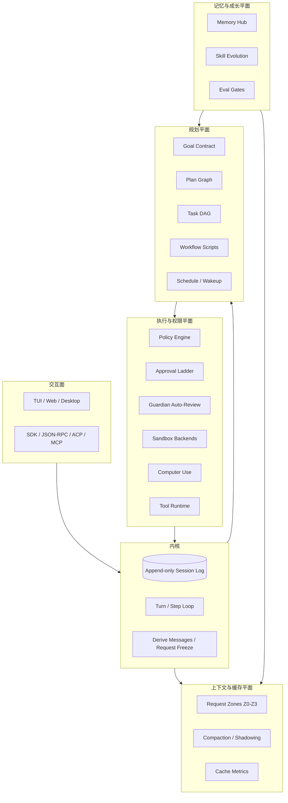
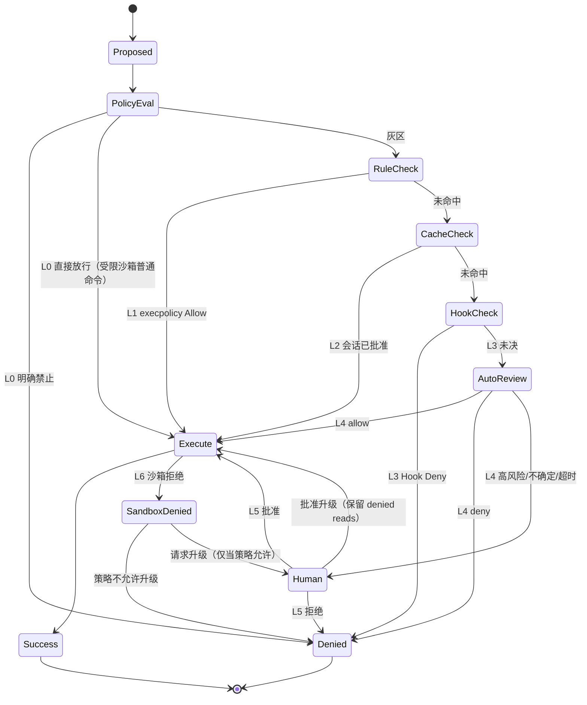
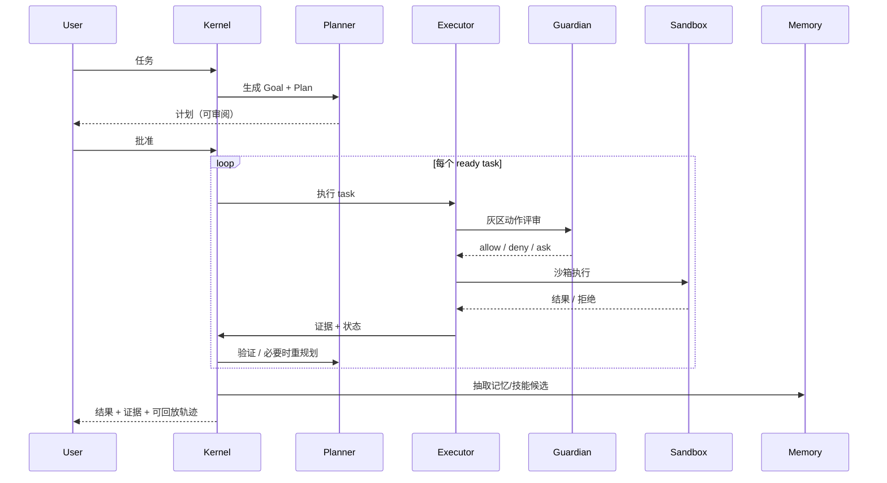

# Weft 参考架构：Trident

> 产品名 **Weft（纬）**，架构代号 **Trident（三叉戟）**：以 **Codex 之手**（执行与权限）、**Claude 之脑**（长程规划与执行控制）、**DSH 之脊**（插件内核、会话日志与缓存友好上下文）为主干，以 **Hermes / Memory Hub 之记忆** 为成长层。品牌与 TUI 规范见 [../brand/README.md](../brand/README.md)。v1.0 冻结范围见 [../PRD.md](../PRD.md) 与 [../ROADMAP.md](../ROADMAP.md)。
>
> 本文是设计综合，不重复三份源码报告的逐行证据；引用格式 `path:line` 均可在 `repos/` 对应仓库中复核。**文中“机制”部分有源码对应，“架构/组合/工期”部分属于综合推导，逐条审计见 [06-derivation-audit.md](06-derivation-audit.md)。** 分报告见 [01-codex.md](01-codex.md)、[02-claude.md](02-claude.md)、[03-dsh.md](03-dsh.md)、[05-appendix.md](05-appendix.md)。

---

## 0. 设计目标与非目标

### 0.1 目标

1. **长程任务能跑完**：小时级到天级任务不漂移、不遗忘、可恢复、可验证。
2. **权限顺滑**：默认不打断人；该拦的拦得住；每次打断都少而准；放行可审计、可撤销。
3. **缓存命中高**：稳定前缀 + 追加式历史，长会话的边际输入成本接近线性下限。
4. **可组合**：执行后端、模型、工具、记忆、UI 都是可替换插件，而不是硬编码在循环里。
5. **可成长**：任务轨迹能沉淀为技能与记忆，但必须过评估门，不能“越学越坏”。
6. **可治理**：多租户、审计、数据保留、最小权限、提示注入防护是架构内建，不是补丁。

### 0.2 非目标

- 不追求“完全无人值守”。高风险操作仍需人类授权或事后复核。
- 不把“自动批准率”当唯一指标。目标是 **单位任务的人类打断次数** 与 **误放行率** 同时下降。
- 不把记忆做成“把所有东西塞进向量库”。记忆是带来源、时效、作用域和冲突消解的策略系统。

### 0.3 三条设计公理

| 公理 | 含义 | 来源 |
|---|---|---|
| **日志即 Agent** | 模型看到的上下文由追加式会话日志投影而来；恢复、回放、缓存、审计、记忆抽取共用同一事实源 | DSH |
| **策略先于权限** | 先问“策略是否允许”，再问“沙箱能否执行”，最后才问“人是否批准” | Codex |
| **计划是可验证数据** | 目标、计划、任务、验收条件都是一等对象，不是提示词里的散文 | Claude |

---

## 1. 三个 Harness 的哲学与可融合性

| 维度 | Codex | Claude Code | DSH |
|---|---|---|---|
| 核心哲学 | 安全默认的执行内核；沙箱优先，必要时才问人 | 产品化的长程工作流；计划、任务、子代理、工作流脚本 | 一切皆插件；会话日志 + 能力缝 + 缓存友好上下文 |
| 权限强项 | 平台沙箱（Seatbelt / Landlock+seccomp / Windows RestrictedToken/MXC）+ 审批策略 + execpolicy + Guardian 自动评审 | allow/deny/ask 规则、managed settings、hooks、permission mode；细粒度工具授权 | approval + 文件策略 + 工具权限；策略变化用追加快照而非改系统提示 |
| 长程强项 | 执行可靠、失败可恢复、审批有记忆；但规划对象较轻 | Goal/Task/Workflow/Subagent/Cron/Checkpoint 一整套 | goal/plan/todo/subagent/schedule/compaction 作为可组合包 |
| 缓存强项 | prompt_cache_key、稳定前缀、压缩 | 上下文压缩、子代理隔离、CLAUDE.md 稳定层 | **把 KV Cache 效应写进每个包的契约**；byte-identical 前缀、追加式快照、压缩复用 warm prefix |
| 电脑使用 | CUA 经 MCP + 按应用 allow/deny + Guardian 多模态评审 + 锁屏策略 | 以浏览器/工具为主，非桌面 CUA 核心 | 原生 CUA provider（macOS Swift）+ 应用同意 + 共享桌面限制 |
| 可组合性 | crate 化、app-server 协议、插件/扩展 | plugins/skills/hooks/MCP，但核心闭源 | Cordis 插件树，连 agent-loop 都可替换 |

**融合判断**：三者不是“选一个”，而是分别覆盖了 Agent 的三个不同失效面：

- Codex 解决 **“敢不敢让它动手”**；
- Claude 解决 **“能不能把长活干完”**；
- DSH 解决 **“能不能便宜、稳定、可替换地一直跑”**。

---

## 2. 总体架构：一内核、四平面、一交互面



### 2.1 内核：事件日志 + 回合/步进循环

内核只做四件事：

1. **追加事实**：`turn/start`、`step/start`、`user/message`、`assistant/message`、`tool/call`、`tool/result`、`turn/end` 等。
2. **投影历史**：`deriveMessages(log)` 得到模型消息序列。
3. **冻结请求**：每次请求把 header、消息数组、工具声明冻结为不可变对象，重试复用同一冻结证据。
4. **发布事件**：`agent/*` 给实时 UI 与策略插件；`session/event` 给持久化、回放、记忆抽取。

DSH 的这条路径已经验证：`docs/architecture.md:83-106` 给出 turn flow，`docs/architecture.md:122-124` 明确“会话日志是模型所见上下文的唯一来源”。融合架构沿用该内核，不把状态散落在各插件里。

### 2.2 规划平面

- **Goal**：一个可被独立评估器验证的完成条件（Claude `ProposeGoalInput`，`sdk-tools.d.ts:3152`）。
- **Plan**：计划模式产出的结构化计划（阶段、依赖、风险、验收）。
- **Task DAG**：`TaskCreate/TaskUpdate` 支持 `blocks/blockedBy/owner`（`sdk-tools.d.ts:2805-2860`）。
- **Workflow**：确定性编排脚本，`agent()/parallel()/pipeline()/phase()`，支持 `resumeFromRunId` 复用已完成调用（`sdk-tools.d.ts:2872-2905`）。
- **Schedule**：cron / wakeup / monitor，用于跨小时、跨天的等待与巡检。

### 2.3 执行与权限平面

见第 4 节。核心是 **决策阶梯**：静态策略 → 确定性记忆 → 模型自动评审 → 人工 → 沙箱兜底 → 失败升级。

### 2.4 上下文与缓存平面

见第 5 节。核心是 **Z0-Z3 四区请求布局** 与 **只追加、不原地改** 的不变量。

### 2.5 记忆与成长平面

见第 7 节。核心是 **四层记忆 + 写入/巩固/检索/治理 + 技能演化评估门**。

---

## 3. 核心数据模型

```ts
type EventId = string & { __brand: 'EventId' };
type SessionId = string & { __brand: 'SessionId' };
type TurnId = string & { __brand: 'TurnId' };
type StepId = string & { __brand: 'StepId' };

interface SessionEvent<T = unknown> {
  id: EventId;
  sessionId: SessionId;
  seq: number;                 // 单调递增，决定投影顺序
  type: string;                // 'turn/start' | 'tool/result' | ...
  at: number;                  // epoch ms
  data: T;
}

interface Goal {
  id: string;
  condition: string;           // 可被独立 evaluator 验证，<= 500 chars
  status: 'proposed' | 'active' | 'achieved' | 'failed' | 'cleared';
  evidence: EventId[];         // 达成证据
  budget?: { tokens?: number; wallClockMs?: number; toolCalls?: number };
}

interface PlanNode {
  id: string;
  parentId?: string;
  goalId: string;
  title: string;
  kind: 'phase' | 'task' | 'check';
  status: 'pending' | 'in_progress' | 'blocked' | 'done' | 'failed';
  dependsOn: string[];         // DAG
  acceptance: string[];        // 可执行验收条件
  owner?: string;              // agent name
  evidence: EventId[];
}

interface CapabilityGrant {
  id: string;
  scope: 'once' | 'turn' | 'session' | 'workspace' | 'standing';
  action: CanonicalAction;     // 规范化后的动作（命令前缀、路径、应用 ID、网络域）
  decision: 'allow' | 'deny';
  issuedBy: 'policy' | 'user' | 'guardian';
  issuedAt: number;
  expiresAt?: number;
  revocable: boolean;
  reason: string;
}

interface ApprovalRequest {
  id: string;
  action: CanonicalAction;
  risk: 'low' | 'medium' | 'high' | 'critical';
  requestedBy: 'model' | 'tool';
  evidence: { screenshot?: string; diff?: string; command?: string };
  proposedRule?: string;       // 批准后可固化的 durable rule
  deadlineMs: number;
}

interface MemoryRecord {
  id: string;
  layer: 'working' | 'episodic' | 'semantic' | 'procedural';
  scope: { tenant: string; user?: string; project?: string; session?: string };
  content: string;
  structured?: unknown;
  source: EventId[];
  confidence: number;          // 0..1
  validFrom: number;
  validTo?: number;
  supersedes?: string[];
  sensitivity: 'public' | 'internal' | 'private' | 'secret';
}
```

**设计要点**：

- 所有“模型可见”的事实必须有 `SessionEvent`；否则无法回放、无法审计、无法参与记忆抽取。
- `CanonicalAction` 是权限系统的关键：同一动作的不同写法必须归一到同一 key（例如命令前缀、绝对路径、应用 bundle/AUMID、URL 域）。
- `CapabilityGrant` 带作用域与过期时间；默认最短。
- `MemoryRecord` 带来源与时效；检索时按作用域与敏感级过滤。

---

## 4. 执行与权限：Codex 式“顺滑”的六层决策 + 沙箱兜底

### 4.1 为什么 Codex 的权限“顺”

Codex 不是“每次操作都弹窗”，而是把权限拆成 **六层决策 + 一层沙箱兜底**（L0–L5 决定“要不要做”，L6 决定“在什么边界里做”）：

| 层 | 决策者 | 回答的问题 | 失败时 |
|---|---|---|---|
| **L0 静态策略** | `approval_policy × permission_profile` | 这类动作原则上是否允许？ | 拒绝 / 直接放行 |
| **L1 确定性规则** | execpolicy 前缀规则 + 危险命令启发式 | 这条命令是否已知安全/已知危险？ | 交下一层 |
| **L2 会话缓存** | `ApprovalStore` | 同类动作本会话是否已批准？ | 交下一层 |
| **L3 Hook** | `PermissionRequest` 钩子 | 组织/插件是否有额外规则？ | Deny 优先 |
| **L4 自动评审** | Guardian（只读、无网、90s） | 风险与用户授权是否足够？ | 超时/失败 → 人工或拒绝 |
| **L5 人工** | TUI/app-server 弹窗 | 高风险/高不确定，需要人判断 | 拒绝/超时 |
| **L6 沙箱兜底** | 平台后端 | 即使批准也在沙箱执行；失败才升级 | 升级保留 deny-read |

> 注意：这是“决策层”，不是无条件串联。L0 可能直接放行（受限沙箱下的普通命令），L1/L2 可跳过 L4/L5；真正的顺序由 `ExecApprovalRequirement` 与 `SandboxOverride` 状态机决定。

这六层决策加沙箱兜底组合起来，用户体验是“大多数时候它自己在跑，偶尔问一次，问的时候有上下文、有建议、有记忆”。

#### 证据

- `AskForApproval` 四档：`UnlessTrusted`、`OnRequest`（默认）、`Granular`、`Never`；`on-failure` 只是 `OnRequest` 的 serde alias，已不是独立策略（`codex-rs/protocol/src/protocol.rs:1146-1169`）。
- `Granular` 五个闸门：sandbox_approval / rules / skill_approval / request_permissions / mcp_elicitations；`false` 表示自动拒绝，而非静默放行（`protocol.rs:1172-1186`）。
- `ReviewDecision` 的“是”有多种持久化粒度：本条 / 本会话 / execpolicy 前缀 / MCP 策略 / 网络主机；每种粒度决定“这次批准能复用多久”（`protocol.rs:4428-4463`）。
- **最关键的放行逻辑**：`OnRequest + Restricted + 未请求越权 → Allow`——普通受限命令根本不弹窗（`core/src/exec_policy.rs:865-874`）。这是“顺”的支点，而不是靠减少安全。
- 默认审批需求由“策略 + 文件沙箱是否受限”共同决定（`core/src/tools/sandboxing.rs:195-236`）。
- 审批缓存按规范化 key 记忆，`ApprovedForSession` 对子集也生效（`core/src/tools/sandboxing.rs:72-118`）。
- Hook 的 `Deny` 直接生效；`Allow` 仅在非人工强制时放行，否则继续走 Guardian/人工（`core/src/tools/approvals.rs:596-621`）。
- Guardian 路由：只有 `policy ∈ {OnRequest, Granular}` 且 `reviewer == AutoReview` 才走自动评审（`ext/guardian-reviewer/src/routing.rs:58-66`）。
- Guardian 结构化输出：`risk_level`、`user_authorization`、`outcome: allow|deny`、`rationale`（`assessment.rs:11-18`）；策略模板给出明确分级：low/medium→allow，high→需授权且动作窄，critical→deny（`prompts/templates/guardian/policy_template.md:69-78`）。
- Guardian **只读、无网、禁止传 `sandbox_permissions`**，评审 agent 权限严格小于被评审 agent（`policy_template.md:62-64`；`settings.rs:44-65`）。
- 90 秒硬超时 + 连续 3 次 deny（或 50 窗口内 10 次）中断整轮，防审批风暴（`deadline.rs:48-64`；`circuit_breaker.rs:1-7`）。
- Guardian 缓存键钉死为 `guardian:{parent_thread_id}`，复用父线程缓存前缀（`ext/guardian-reviewer/src/session.rs:18-30`）。
- 网络拒绝不杀进程：转成异步 host 批准，进程原地等，批准后继续（`core/src/tools/network_approval.rs:198-290`）。
- `request_permissions` 工具让模型显式申请最小权限；授予作用域是“本回合”或“本会话”（`core/src/tools/handlers/request_permissions.rs:38-80`；`shell_spec.rs:186-189`）。
- 授权 = 请求 ∩ 批准：客户端只能给更少，不能给更多；双方的 deny 取更严（`sandboxing/src/policy_transforms.rs:147-220`）。
- 首次尝试默认沙箱；只有显式升级且已获批才放宽；若策略包含 denied reads，则不允许无沙箱执行（`core/src/tools/sandboxing.rs:253-314`）。
- 平台沙箱：macOS Seatbelt；Linux 实际是 bubblewrap + seccomp（legacy Landlock 只用于非文件系统受限路径）；Windows 有 RestrictedToken / Elevated ACL / MXC 三条后端（`sandboxing/src/manager.rs:50-64`；`report/01-codex.md` §2.2）。
- CUA 不在 Codex repo 内实现，而是 MCP 连接器 `cua_repl` / `node_repl` / `connector_openai_browser`，归入 `GuardianScope::ComputerUse`；按 `browser_use` / `computer_use` 下发确认策略（`core/src/mcp_tool_call.rs:1438-1462`；`protocol/src/mcp.rs:41-52`）。
- 每应用授权：macOS bundle_id、Windows AUMID/EXE publisher+product+binary，支持 default_app_access / allow_locked_computer_use / allow_persistent_approval（`config/src/computer_use.rs:9-35`；`config/src/browser_computer_use_requirements.rs:114-137`）。

### 4.2 决策阶梯与状态机



**关键规则**：

- **先执行、后升级**：能在沙箱里完成就不问人。沙箱失败才升级，且升级请求必须带“失败证据 + 建议规则 + 风险说明”。
- **永不静默放宽**：升级只放宽必要的维度；若存在 denied reads，不允许整体绕过沙箱（Codex 的 `unsandboxed_execution_allowed` 思路，`tools/sandboxing.rs:294-314`）。
- **只评审真实重试权限**：升级重试前，把审批对象改写为 `RequireEscalated`，避免“先请求小的骗过评审再放大”（`core/src/tools/orchestrator.rs:491-554`）。
- **授权版本绑定**：任何“上次说可以”的缓存都要带 permissions/settings/environments/history/root 版本；版本变了必须重评（`ScoreAuthorization.is_current`）。
- **强制人工检查点不可被缓存/Guardian 满足**：`prompt-user` / `NeedsHumanApproval` 必须真人，断线时直接拒绝而不是放行（`app-server/README.md:1-16`）。
- **批准即规则候选**：同一动作第 N 次被批准时，提示“是否固化为 workspace/session 规则”，把重复打断变成一次性配置。
- **拒绝要有出路**：结构化拒绝包含原因、替代方案、可申请的最小权限；模型可以据此改道，而不是卡死。
- **熔断**：连续拒绝 / 短窗口拒绝超阈值 → 暂停该回合并请人介入（Guardian circuit breaker）。
- **审计**：每次决策记录 `policy_version / grant_id / reviewer / latency / outcome`，可回放。

### 4.3 权限“顺滑”的 15 个工程手段

| # | 手段 | 效果 | Codex 锚点 |
|---|---|---|---|
| 1 | 受限沙箱下的普通命令 = 直接 Allow | 绝大多数命令零弹窗 | `exec_policy.rs:865-874` |
| 2 | 逐命令 `with_additional_permissions` | 不为一条命令降级整个会话 | `models.rs:66-94` |
| 3 | 四种持久化粒度（本条/会话/前缀规则/网络主机） | 一次人工换长期安静 | `ReviewDecision` |
| 4 | 网络拒绝 → 异步 host 批准 | 进程原地等，不杀命令 | `network_approval.rs:198-290` |
| 5 | Guardian 只读/无网/90s/熔断 | 无人值守也能推进 | `deadline.rs`、`circuit_breaker.rs` |
| 6 | Adaptive 分数 + 授权版本校验 | 低风险直接过，不会用过期授权 | `ScoreAuthorization` |
| 7 | 升级只评审“真实重试权限” | 堵住“先小后大” | `orchestrator.rs:491-554` |
| 8 | deny-read 存在时永不真无沙箱 | 升级 ≠ 塌边界 | `sandboxing.rs:294-314` |
| 9 | 强制人工检查点不可被缓存满足 | 少数高危动作必须真人 | `app-server/README.md:1-16` |
| 10 | `Granular` false = 自动拒绝，不是静默放行 | 企业可精确关掉某类弹窗 | `protocol.rs:1172-1186` |
| 11 | 按应用/域授权（CUA/浏览器/网络） | 一次授权覆盖一类操作 | `computer_use.rs`、`browser_computer_use_requirements.rs` |
| 12 | 批量/并行审批 + 预评审预热 | 多工具调用合并交互 | `guardian/review.rs:239-252` |
| 13 | 结构化拒绝 + `request_permissions` | 模型能自我修复 | `request_permissions.rs:38-80` |
| 14 | 检查点/撤销 | 降低“事前批准”的必要性 | 融合层新增（Claude/DSH） |
| 15 | 可观测的打断率 / 误放行率 | 用数据驱动策略调优 | 融合层新增 |

### 4.4 电脑使用（CUA）的融合设计

融合架构把 CUA 当作 **“带物理副作用的工具”**，而不是普通工具：

```text
Perception:  screenshot + accessibility tree + OCR + window/app metadata
     ↓
Planner:     目标 → 下一步 UI 动作（click/type/key/scroll/drag）
     ↓
Consent:     app allowlist (bundle_id / AUMID / exe publisher) + locked-screen policy
     ↓
Review:      Guardian 看“意图 + 截图 + 历史授权 + 敏感应用名单”
     ↓
Act:         输入注入（坐标映射、焦点校验、动作后校验）
     ↓
Journal:     before/after 截图 + 动作 + 结果 + 可回放
```

**安全不变量**：

- 屏幕内容永远是 **不可信数据**，不能成为指令；指令只来自系统策略与用户。
- 密码管理器、银行、支付、系统设置等敏感应用默认拒绝或强确认。
- 锁屏状态默认禁止 CUA；需要显式 `allow_locked_computer_use`。
- 每个动作可归因到 `goal/task/step`；支持“停止并接管”。
- 高风险任务在独立桌面/VM/用户会话中执行；共享桌面需显式协调。
- 动作日志默认保留 N 天，支持审计与事故复盘。

**先厘清一个事实**：Codex 开源仓库**没有内建 CUA 工具**。工具注册表里没有 screenshot/click/AX 原语；CUA 能力在 MCP 连接器 `cua_repl` / `node_repl` / `connector_openai_browser` 内，Codex 只做三件事：工具代理、`GuardianScope::ComputerUse` 差异化审核、按 app 的静态 allow/deny 与锁屏/持久批准策略（`report/01-codex.md` §4.1-4.3）。DSH 则提供**原生 provider 注册**：同一部署只能启用一个 computer-use provider，provider 自己提供工具与桌面操作，DSH 负责互斥注册与共享桌面限制（`packages/computer-use/computer-use/README.md:12-36,73-80`）。

| 维度 | Codex | DSH | 融合架构 |
|---|---|---|---|
| 驱动 | MCP 连接器（repo 外） | 原生 provider / Cua Driver | **可插拔 driver**（MCP/native/remote VM） |
| 授权 | bundle_id / AUMID / EXE + 全局默认 | provider 自带 consent | 统一 `AppConsent` 服务 |
| 审核 | Guardian ComputerUse 域 | provider 决定 | 统一 Guardian + 动作级策略 |
| 锁屏/持久 | `allow_locked_computer_use` / `allow_persistent_approval` | 共享桌面限制 | 统一策略字段 |
| 审计 | MCP 活动单元 | 无统一动作日志 | **动作日志 + 前后截图** |

融合架构应把“驱动”和“治理”解耦：**驱动可换，治理必须内建**。

### 4.5 Windows 沙箱：三条后端与选择策略

Windows 是当前工作环境，也是权限设计最容易翻车的地方。Codex 在 2026 年给出了三条互补后端：

| 后端 | 是否提权 | 核心机制 | 适用 | 代价 |
|---|---|---|---|---|
| **RestrictedToken** | 否 | 受限令牌 + WRITE_RESTRICTED + ACL carveout | 日常开发、快速启动 | 能力表达有限；部分 deny-read 无法参与读检查 |
| **Elevated ACL** | 是（setup/service） | 专用用户/ACL + Windows 服务 + DPAPI + 目录 ACL | 需要细粒度 deny-read、强隔离 | 安装/维护成本；提权面 |
| **MXC BaseContainer** | 否 | Microsoft MXC `BaseContainerRunner` + PSEC | 严格文件/网络策略、现代 Windows | 需要 PSE 能力；硬链接/卷根别名有限制 |

Codex 的关键工程决策：

1. **权限 profile 是规范源**：三条后端都从同一个 `PermissionProfile` 翻译，而不是各自维护一套规则（`sandboxing/src/windows.rs:15-31`）。
2. **显式选择，失败不回退**：`windows.sandbox = "mxc"` 是严格模式；MXC 不可用或策略不支持时直接失败，不会静默退回弱后端（`mxc-sandbox/README.md:49-58`）。
3. **能力探测而非版本猜测**：MXC 用 `is_available()` 做 create/close 探针；deny 路径还需要 `PSE_SUPPORT_FS_DENY`，否则启动前失败（`mxc-sandbox/README.md:13-17`）。
4. **网络是独立维度**：WFP 负责出站/入站与代理，MXC 下 loopback 默认允许、非 loopback 直连拒绝；代理域规则仍生效（`mxc-sandbox/README.md:88-94`）。
5. **保护元数据**：`.git/hooks`、`.codex` 等即使在可写根下也保持只读（`protocol.rs:1282-1298`）。
6. **失败要可解释**：denial 分类、violation 事件、`codex sandbox windows` 调试路径，让模型和用户都知道“为什么被拦”。

融合架构应沿用这三点：**同一权限 profile、显式后端选择、失败不回退**。静默回退是权限系统最危险的“顺滑”。

---

## 5. 缓存优先上下文：DSH 式高命中

> DSH 的设计原点不是“缓存管理器”，而是一条可检验的不变式：**Model-visible ⟺ durably referenced**——凡是进入模型请求的内容，都必须能从会话日志与不可变引用对象重建；任何人拿着日志、附件与固定代码版本，都能逐字节重建每个请求。其直接推论才是：**追加式日志 + 逐节点纯函数投影 ⇒ 请求是前一个请求的 append-extension，前缀稳定是涌现结果，不是被“管理”出来的**（`repos/dsh/.agents/notes/implemented/architecture/2026-07-05-reconstructable-requests.md:17-19`）。这比“加一个缓存层”更深：它把“别破坏缓存”从纪律问题变成了类型与接口问题。

### 5.1 请求四区布局

```text
┌─────────────────────────────────────────────────────────────┐
│ Z0 稳定层：系统策略 + 工具声明（按版本冻结，字节稳定）        │
├─────────────────────────────────────────────────────────────┤
│ Z1 历史层：user/assistant/tool 消息，只追加                  │
├─────────────────────────────────────────────────────────────┤
│ Z2 运行时快照：cwd/策略/时间/环境，变化时追加，不改旧内容     │
├─────────────────────────────────────────────────────────────┤
│ Z3 指令层：本轮任务、steering、压缩摘要（尾部）               │
└─────────────────────────────────────────────────────────────┘
```

**Z0 稳定层**：系统提示按 section 固定顺序渲染；工具 schema 按稳定排序序列化；任何变更都生成新版本并在 `request/header` 记录原因。DSH 把这件事做成了代码契约：`SECTION_ORDERS` 固定身份/计划/沙箱/工具等段落的顺序（`packages/core/system-prompt/src/index.ts:136-175`）；工具默认按名字典序装配，且与 provider 注册顺序无关（`packages/core/system-prompt/tests/tool-order.spec.ts:27-43`）；动态上下文不塞进 system prompt，而是物化为 durable user-role snapshot（`index.ts:78-90`）。

**Z1 历史层**：只追加。工具结果、错误恢复、取消占位都追加在尾部，不重写前面的消息。

**Z2 快照层**：DSH 的做法值得直接照搬——策略变化时系统提示保持字节不变，把“当前策略快照”作为新的 context 消息追加在历史之后（`packages/sandbox/sandbox-policy/README.md:144-146`）。这样旧前缀仍然命中。

**Z3 指令层**：当前任务、纠偏、压缩摘要放最后；它们变化不影响前面。

### 5.2 七条不变量

1. **Byte-identical prefix**：同一 provider/model/series 下，已发送的前缀必须逐字节一致；否则从第一个差异 token 起全部 miss（`packages/core/agent-loop/README.md:162-164`）。
2. **Append-only**：普通历史增长只追加；surface replacement / compaction 才会让旧区域“被遮蔽”，但不是删除（`agent-loop/README.md:176-178`）。
3. **Prompt 变更只追加**：`systemPromptUpdate: 'in-history'` 的路由把新提示追加在缓存历史之后，而不是原地替换（`agent-loop/README.md:164`）。
4. **工具声明版本化**：工具定义变化会使从第一个变更 token 起失效；因此工具集变更应显式开启新 series，并记录增删（`agent-loop/README.md:164`）。
5. **压缩复用 warm prefix**：压缩请求回放 system prompt、工具与阴影区消息，逐字节匹配上次请求，只让尾部指令与摘要输出不缓存（`packages/compaction/compaction-basic/README.md:243-245`）。
6. **缓存键稳定**：同一会话/系列的 `prompt_cache_key` 必须稳定；Codex 用 session-derived key，Guardian 评审钉死为 `guardian:{parent_thread_id}` 以复用父线程缓存（`core/src/client.rs:709-740`；`ext/guardian-reviewer/src/session.rs:18-30`）。不要每轮换 key。
7. **压缩保留结构，而非纯摘要**：Codex 的压缩产物是“摘要 + 重新注入的 prefix/context”，并带 `window_number`、`compaction_response_id`、`compaction_model_hash` 等可回溯元数据（`core/src/compact.rs:63-170`）。纯摘要会丢掉“模型当时看到的世界状态”。

### 5.3 压缩即“投影”，不是“改写”

融合架构采用 **shadowing（遮蔽）** 而非删除：

- 压缩产生一个 `compaction` 事件，记录被遮蔽的区间与摘要。
- `deriveMessages()` 投影时用摘要替换被遮蔽区间；原始事件仍在日志里。
- 下次压缩可以回放“上次请求 + 摘要指令”，复用 warm prefix。
- 支持 checkpoint/rewind：回到压缩前只需改变投影起点，不丢历史。

### 5.4 缓存观测

每个请求记录：

- `prompt_cache_key` / series id / header version
- `cache_read_tokens` / `cache_write_tokens` / `cache_hit_rate`
- **首个 miss 的位置**（第几条消息/第几个 token），并归因到：system 变更、tool schema 变更、历史重写、图片占位变化、provider 路由变化
- 每次 compaction 的缓存收益与信息损失评估

**回归测试**：对关键会话录制请求序列，断言前缀哈希稳定；工具变更、策略变更、压缩操作分别有快照测试。

### 5.5 多代理的缓存共享

- 子代理默认 **fork 父前缀**：同一 provider/model/system/tools 下，子代理只追加自己的任务与 runtime context（DSH `tool-agent-team` 的做法，`packages/experimental/tool-agent-team/README.md:135`）。
- 子代理的工具集若与父不同，必须在 fork 点开启新 series，并明确“缓存不复用”的代价。
- 并行子代理各自独立前缀；不要为了“共享缓存”强行合并不同任务的上下文。

### 5.6 Provider 差异：自动前缀缓存 vs 显式断点

| Provider 形态 | 缓存机制 | 融合架构的做法 |
|---|---|---|
| DeepSeek 原生 | 服务端自动前缀缓存；客户端不发 `cache_control` | 只保证前缀稳定；用 `cacheReadTokens` 观测（DSH 的默认路径） |
| Anthropic Messages | 显式 `cache_control` 断点（最多 4 个），区分 5m/1h retention | 在 Z0 末尾、Z1 末尾、Z3 末尾设断点；断点位置要稳定 |
| OpenAI Responses | `prompt_cache_key` + 自动前缀匹配 | 按 session/series 设稳定 key；不要每轮换 key |
| OpenAI-compatible / 自建 | 取决于网关；可能支持 `cache_control` 或自动 | 由适配器声明能力，路由层据此选择“原地替换/尾部追加/新 series” |

DSH 的做法是把“缓存友好度”做成**路由能力**：适配器在 `prepareCall()` 声明 `systemPromptUpdate: 'in-history'`、`toolUpdate: 'in-history' | 'addition-only'`；支持的 provider 把变更往后放，不支持的才退化成原地替换（`report/03-dsh.md` §3.8）。融合架构应沿用：**同一套请求构造逻辑，按路由能力选择最优序列化，而不是假设所有 provider 一样。**

**不要过度归因**：DSH 的 DeepSeek 适配器并不发送显式 `cache_control`；只有走 `llm-pi-ai`（Anthropic/OpenAI-compat）时才由上游按 `cacheControlFormat` 生成 marker（`report/03-dsh.md` §3.8）。因此“高命中”不能只归功于客户端技巧，服务端缓存策略同样是变量。

---

## 6. 长程规划与执行：Claude 式“计划-执行-验证”

### 6.1 目标契约（Goal Contract）

- 目标不是“把事做好”，而是一个 **独立评估器可验证的完成条件**。
- 例：`bun test test/auth 退出码为 0，且没有跳过用例`。
- 目标需要人批准（除非用户原话已经明确）；支持 `/goal clear`。
- 评估器独立于执行者：可以是测试命令、diff 检查、另一个子代理、或人类。

### 6.2 计划图与任务 DAG

- **Plan mode 不是独立规划器**：它本质是“只读强制前言 + 工作流正文 + ExitPlanMode 协议 footer”的 system reminder；计划落盘为文件（`ExitPlanModeOutput.filePath`），压缩后从磁盘重注入。这保证“计划外置”，不依赖模型记住（`sdk.d.ts:2057-2062`；`sdk-tools.d.ts:3395-3421`）。
- **Task DAG**：每个任务有 `blockedBy/blocks/owner/acceptance`；任务状态变化是持久事件（`sdk-tools.d.ts:2805-2870`）。
- **Todo 的定位要修正**：2.1.233 起 TodoWrite/Task 四件套在 Opus 4.8+/Sonnet 5+ 默认退役（官方理由：新模型不需要书面清单，`CHANGELOG.md:4288`）。因此 Todo 应作为“给人/宿主看的进度投影”，而不是执行力的核心机制；真正的执行力来自计划文件、验收条件、独立验证与恢复。
- **计划不是一次性**：新信息、失败、预算超限触发 re-plan；re-plan 要保留旧计划与原因，形成决策轨迹。

### 6.3 计划-执行-验证循环

```text
Goal
  → Plan (可审阅)
  → Task DAG
  → for each ready task:
        execute (sandboxed)
        → gather evidence (tool result / diff / test)
        → verify against acceptance
        → pass: mark done + record evidence
        → fail: classify (transient/permanent/unknown)
              → retry / re-plan / ask human
  → Goal evaluator (independent)
  → done | continue | escalate
```

**执行力的关键不是“更聪明的计划”，而是：**

1. **状态外置到四介质**：`transcript`（追加事实）+ `plan 文件`（计划）+ `文件快照`（回滚）+ `session_store`（宿主 resume）；不依赖模型记忆。
2. **每步可验证**：验收条件前置，避免“做完了才发现不对”。
3. **失败分类**：transient（重试）、permanent（改方案）、unknown（查外部状态/问人）。
4. **三个不同主体**：计划（模型 + 用户批准）、执行（主循环 + 子代理）、验证（独立模型 / 全新子代理 / 脚本退出码）。执行者不给自己打分。
5. **压缩有留存契约**：明确“压缩后哪些必须重建、哪些允许丢”（plan、CLAUDE.md、skills、最近文件）；对 hook 注入内容单独限流。
6. **预算与熔断**：token/时间/工具调用/连续失败都有上限。

### 6.4 子代理与工作流

- **子代理**：默认后台运行，命名后可 `SendMessage`；支持 worktree/remote 隔离（Claude `AgentInput`，`sdk-tools.d.ts:775-820`）。
- **工作流脚本**：确定性编排，`agent()/parallel()/pipeline()/phase()`；`resumeFromRunId` 是**节点级缓存**——已完成且 prompt/opts 未变的 `agent()` 调用直接返回缓存结果，只重跑被改动或新增的调用（`sdk-tools.d.ts:2872-2905`）。这是长程任务里最容易被忽略、却最有效的加速手段。
- **适用边界**：
  - 子代理适合“上下文隔离、并行探索、独立验证”。
  - 工作流适合“步骤固定、需要重放/恢复、需要并行扇出”的任务。
  - 不要用子代理替代任务 DAG；子代理是执行者，DAG 是控制面。

### 6.5 检查点、恢复与防漂移

- **Checkpoint**：每完成一个任务/每 N 步，记录可恢复点（日志 seq、工作区 diff、任务状态）。
- **Rewind / Resume 共用消息 ID**：同一套 message id 既支持“从某条消息分叉”，也支持“回滚到某条 user message 的文件状态”；不要为回滚单独造一套坐标。
- **Rewind**：回到检查点，保留“为什么回退”的记录。
- **Resume**：进程重启后从日志恢复；未完成工具调用标记“结果未知”，只对只读/幂等操作自动重试。
- **Progress Ledger**：每轮写“已完成/进行中/阻塞/下一步”，防止长上下文里丢失主线。
- **Anti-drift**：每次 re-plan 检查“当前动作是否仍服务于 Goal”；连续 N 步无进展则升级。

### 6.6 调度与后台

- Cron / wakeup / monitor 用于：等待 CI、等待外部事件、定时巡检、长任务分段。
- 后台任务必须有 owner、超时、取消、结果投递；不能“发射后不管”。

---

## 7. 记忆与成长：Hermes + Memory Hub

> 详细源码与工业级选型见 [05-appendix.md](05-appendix.md)。本节只给融合架构中的接口与边界。

### 7.1 四层记忆

| 层 | 内容 | 存储 | 生命周期 |
|---|---|---|---|
| Working | 当前会话上下文 | 会话日志 + 上下文窗口 | 回合/会话 |
| Episodic | 任务摘要、决策、检查点 | 会话摘要/事件 | 周/月 |
| Semantic | 事实、偏好、实体、关系 | Memory Hub（向量+图+KV） | 长期，带时效 |
| Procedural | 技能、提示词、工作流 | Skill Registry | 长期，版本化 |

### 7.2 写入/巩固/检索/治理

```text
Session events
  → candidate extraction (LLM + rules)
  → dedupe / conflict detection
  → consolidation (merge, supersede, expire)
  → index (vector + BM25 + graph)
  → retrieval (scope filter + hybrid rank + token budget)
  → injection (as Z2/Z3 context, with citations)
```

**治理不变量**：

- 每条记忆有来源事件、置信度、时效、作用域、敏感级。
- 删除/更正必须传播（supersedes / tombstone），不能只追加新版本。
- 跨租户隔离；PII/secret 默认不进入 semantic 层。
- 检索结果按“相关性 × 时效 × 置信度 × 作用域”排序，并受 token 预算约束。
- 防投毒：外部内容进入记忆前要标记来源与信任级；不可信内容不能成为“用户授权”。

### 7.3 技能演化与评估门

```text
Trajectory → Reflection → Skill Proposal → Offline Eval → Canary → Promote / Rollback
```

- 技能是 **版本化制品**：名称、触发条件、步骤、工具依赖、失败模式、评估结果。
- 演化可以用 DSPy/GEPA 优化提示词/技能，但必须在 held-out 任务上评估。
- **安全策略、权限规则、系统提示不可由自我演化修改**；只能由人审。
- 评估指标：成功率、成本、延迟、缓存命中、审批打断次数、回归失败率。

### 7.4 与主循环的接口

- **读**：在 `agent/pre-step` 阶段按需检索，注入 Z2/Z3；不要每步全量注入。
- **写**：在 `turn/end` / `task/done` 后异步抽取，不阻塞主循环。
- **反馈**：用户纠正、测试失败、审批拒绝都是高价值负样本，优先写入 episodic。
- **可见性**：用户可查看/编辑/删除记忆；记忆命中要能解释“为什么想起这个”。

### 7.5 与工业级 Memory Hub 的对接（结论）

结合 [05-appendix.md](05-appendix.md) 的六家拆解，Trident 的记忆层采用 **hot/cold 分层**，而不是“选一个 memory 产品”：

| 路径 | 方案 | 理由 | 落到哪里 |
|---|---|---|---|
| **Hot path**（会话内、每轮可能读） | Hermes 式预算文本记忆（MEMORY/USER，硬字符上限，超限模型自合并，失败熔断） | 零额外 LLM 调用、缓存稳定、可解释；重复条目每轮都付费，所以必须硬预算 | §7.1 Working/Episodic；§7.4 读接口 |
| **Cold path**（跨会话事实） | Zep/Graphiti 式时序图（边带生效/失效区间 + 摄取时间；旧事实失效不删除） | 能回答“当时是什么”；纯向量结构上做不到 | §7.1 Semantic；§7.2 consolidation |

> 物理拓扑与 2026 工业架构对比见 [10-memory-architecture-2026.md](10-memory-architecture-2026.md)：推荐 PG+pgvector+图 为权威、Redis/Valkey 为热/队列、对象存储为冷层。
| **写入** | ADD-only 单次抽取（Mem0 2026 路线）+ 来源/置信度/时效 | 降低写入成本与改写丢证据风险；判别力交给检索 | §7.2 写入/巩固 |
| **检索** | 语义 + BM25/grep + 图三路混合 + token 预算 + 作用域/敏感级过滤 | 单信号 top-k 已落后；文件系统 + grep 也能很强 | §7.2 retrieval |
| **治理** | dataset × tenant 两级隔离 + user/role/tenant 授权 + 审计/溯源 | 按 user_id 过滤不可审计；企业场景治理是一等公民 | §7.2 治理不变量 |
| **评测** | LongMemEval 子集（含知识更新/弃答）+ MemoryAgentBench 增量场景 | LoCoMo 已饱和且不可横比 | §7.3 评估门；§11 |

**关键取舍**：时序图不能进 hot path。每轮抽取会引入额外 LLM 调用与不稳定前缀，直接违反 §5 的缓存不变量；hot path 必须是“零调用、字节稳定、可预算”的文本记忆。

---

## 8. 插件与组合：DSH 式内核

融合架构采用 **能力缝（capability seam）**：

- **Service Definition**：接口与语义（如 `Sandbox`、`MemoryHub`、`ModelProvider`）。
- **Service Provider**：实现（本地/远程/云）。
- **Consumer**：工具、循环、UI。

**规则**：

1. 每个贡献都是可撤销的 effect；插件卸载即回滚。
2. 业务规则放独立插件，不塞进循环。
3. 配置变更通过 patch/overlay，不 fork 内核。
4. 模型可见的文本/工具 schema 要有快照测试。
5. 任何“模型可见”的新输入都必须能从日志重建。

这让“Codex 沙箱”“Claude 规划”“Hermes 记忆”都能作为插件接入，而不是把三套代码焊死。

---

## 9. 关键接口（建议）

```ts
interface SandboxBackend {
  readonly kind: 'seatbelt' | 'landlock' | 'windows-restricted' | 'windows-elevated' | 'mxc' | 'container';
  prepare(profile: SandboxProfile): Promise<PreparedSandbox>;
  exec(req: ExecRequest, prepared: PreparedSandbox): Promise<ExecResult>;
  explainDenial(result: ExecResult): DenialExplanation;
}

interface PolicyEngine {
  evaluate(action: CanonicalAction, ctx: PolicyContext): PolicyDecision;
  // decision: allow | deny | ask | sandboxed-only
}

interface ApprovalService {
  request(req: ApprovalRequest): Promise<ApprovalDecision>;
  remember(grant: CapabilityGrant): Promise<void>;
  revoke(grantId: string): Promise<void>;
}

interface Guardian {
  review(req: GuardianReviewRequest): Promise<GuardianAssessment>;
  // assessment: risk, user_authorization, allow|deny, rationale
}

interface ContextAssembler {
  assemble(input: AssembleInput): FrozenRequest;
  // 保证 Z0-Z3 顺序与 byte-identical 不变量
}

interface Compactor {
  compact(session: SessionView, range: EventRange): Promise<CompactionEvent>;
  // 回放 warm prefix，输出 shadow + summary
}

interface Planner {
  proposeGoal(input: GoalInput): Promise<Goal>;
  plan(goal: Goal, ctx: PlanContext): Promise<PlanNode[]>;
  replan(reason: ReplanReason): Promise<PlanNode[]>;
}

interface Verifier {
  verify(task: PlanNode, evidence: Evidence[]): Promise<VerifyResult>;
}

interface MemoryHub {
  write(records: MemoryRecord[]): Promise<void>;
  search(query: MemoryQuery): Promise<MemoryHit[]>;
  forget(selector: MemorySelector): Promise<void>;
}
```

---

## 10. 端到端时序：一个长任务的生命周期



---

## 11. 评测与可观测性

| 类别 | 指标 | 目标 |
|---|---|---|
| 任务 | 成功率、完成时间、人工介入次数 | 成功率↑，介入↓ |
| 权限 | 误放行率、误拦截率、审批延迟 P50/P95、审批风暴次数 | 误放行→0，延迟↓ |
| 缓存 | cache hit rate、首 miss 归因、每任务输入成本 | 命中↑，成本↓ |
| 规划 | 计划完成率、re-plan 次数、任务 DAG 阻塞时长 | 完成率↑，漂移↓ |
| 记忆 | 检索 precision/recall、过期事实比例、投毒拦截 | 质量↑ |
| 成长 | 技能提升幅度、回归失败率、canary 回滚率 | 提升显著且可回滚 |
| 安全 | 沙箱逃逸尝试、敏感应用拦截、注入样本通过率 | 0 逃逸 |

**评测方法**：

- 离线：固定任务集 + 录制会话回放 + 故障注入。
- 在线：canary、A/B、影子模式（只评审不执行）。
- 红队：提示注入、恶意 MCP、越权 CUA、审批绕过。

---

## 12. 路线图

> 本节是**依赖序子集**，不是 PRD 全集；PRD 与 roadmap 的集合覆盖审计（24 类、14 项不做、13 项延后、8 项新增）见 [07-prd-roadmap-union-audit.md](07-prd-roadmap-union-audit.md)。同一能力只做一次、选谁/为什么/适配层见 [08-capability-selection.md](08-capability-selection.md)。

### 12.0 复用 / 自建 / 采购

| 模块 | 建议 | 理由 |
|---|---|---|
| 沙箱后端 | 复用 Codex 的 Rust crate（sidecar `sandbox-exec` 服务）或移植 Windows ACL/MXC 逻辑 | 平台细节多、测试成本高；Codex 已验证 |
| 会话日志 / 插件内核 | 直接 fork DSH（MIT）或复用 Cordis 设计 | 缓存、回放、插件是一体；重造成本最高 |
| 规划 / 工作流 | 借 Claude 的对象模型与协议，不抄实现（闭源） | Goal/Task/Workflow/Checkpoint 的接口设计成熟 |
| Guardian | 自建（模型 + 策略模板 + 只读工具 + 超时/熔断） | 与自家权限模型强耦合，采购难适配 |
| Memory Hub | hot path 自建（Hermes 式文本记忆）；cold path 采购/嵌入 Zep/Graphiti/Mem0 | 冷路径工程量大；热路径必须缓存友好 |
| CUA 驱动 | 优先 MCP/native provider；治理自建 | 驱动可替换；治理是差异化 |
| UI / 协议 | DSH Web/Desktop + Codex app-server 风格 JSON-RPC | 已有可用的 Web/桌面与审批回调 |

**最小可运行切片（M0 验收）**：一个真实任务在 Windows 上完成“读文件 → 改文件 → 跑测试”，全程有会话日志、有请求分区、有审批缓存、有沙箱后端、有可回放轨迹；缓存命中率与打断次数可观测。

### M0：内核与权限底座（2-3 周）

- 会话日志 + 投影 + 请求冻结
- Z0-Z3 请求布局 + 前缀哈希测试
- PolicyEngine + ApprovalService + 审批缓存
- 至少一个沙箱后端（Windows 优先，因为当前环境）

### M1：Guardian 与 CUA 治理（4-6 周）

- Guardian 自动评审（风险/授权/历史检索/超时/熔断）
- CUA 驱动抽象 + 按应用授权 + 锁屏策略 + 动作日志
- 审批规则固化 + 批量审批 + 打断率指标

### M2：长程规划与恢复（6-8 周）

- Goal/Plan/Task DAG
- 计划模式 + 验证器 + 失败分类
- Checkpoint/Rewind/Resume
- 子代理 + 工作流脚本

### M3：记忆与成长（6-8 周）

- Memory Hub MVP（episodic/semantic）
- 检索注入 + 引用 + 治理
- 技能演化 + 离线评估 + canary

### M4：多租户与生态（持续）

- 租户隔离、审计、配额
- 插件市场、远程执行后端
- 持续评测与红队

---

## 13. 风险与反模式

| 风险 | 表现 | 缓解 |
|---|---|---|
| Guardian 误判 | 放行危险动作 / 拦截正常动作 | 多模型评审、规则兜底、影子模式、人工复核样本 |
| 审批疲劳 | 用户习惯性点“允许” | 减少打断、风险分级、批量、规则固化、撤销 |
| 缓存僵化 | 为命中而不敢更新上下文 | Z2 追加快照、显式 series、压缩投影 |
| 计划剧场 | 计划很漂亮但执行失败 | 验收条件前置、独立验证、失败分类 |
| 子代理发散 | 重复劳动、上下文割裂 | 任务 DAG 唯一控制面、写作用域、结果汇总 |
| 记忆投毒 | 错误事实长期污染 | 来源/置信度/时效、冲突消解、审计、删除传播 |
| 自我演化失控 | 技能越改越差 | held-out eval、canary、回滚、安全策略不可演化 |
| 过度自动化 | 无人监督的高风险操作 | 风险分级、强制确认、独立桌面/VM、保险丝 |

**反模式**：

- 把“权限”做成一个布尔开关（allow all / ask all）。
- 把“计划”写进系统提示，而不是一等对象。
- 每次请求重写 system prompt。
- 用“更长的上下文”代替“更好的记忆”。
- 让执行者自己给自己打分。
- 让自我演化修改安全策略。

---

## 14. 结论

融合后的 Agent 不是“三个 harness 的功能拼接”，而是三种失效面的互补：

- **Codex 之手**：让动作敢发生，且发生在可解释、可回滚、可审计的边界内。
- **Claude 之脑**：让长活有目标、有计划、有验收、有恢复。
- **DSH 之脊**：让一切可组合、可回放、可缓存、可替换。
- **Hermes / Memory Hub 之记忆**：让每次任务都变成下一次的起点，而不是从零开始。

一句话：**“策略治理的执行 + 可验证的长程规划 + 缓存友好的事件内核 + 带评估门的记忆成长。”**
